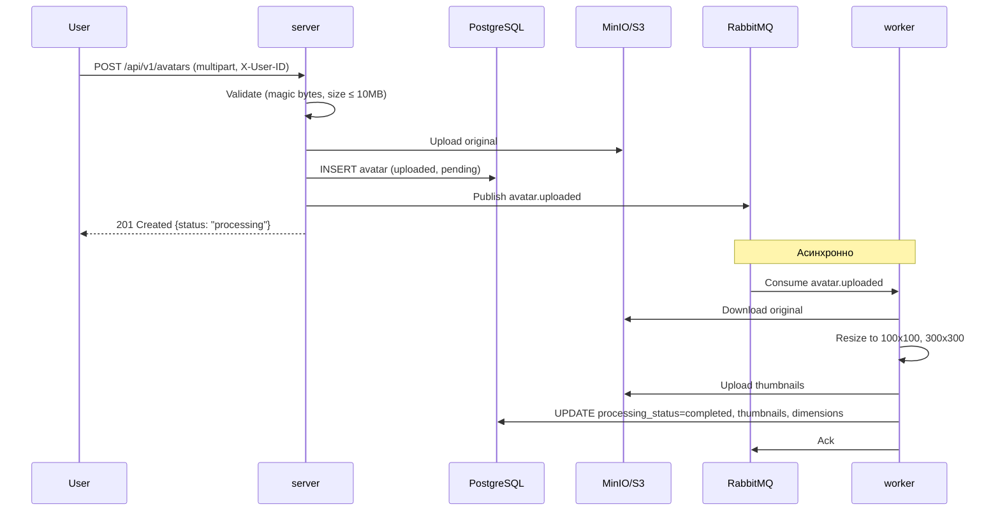
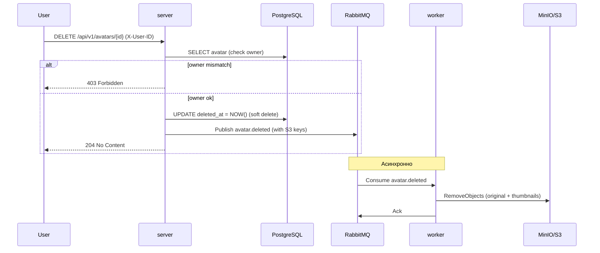
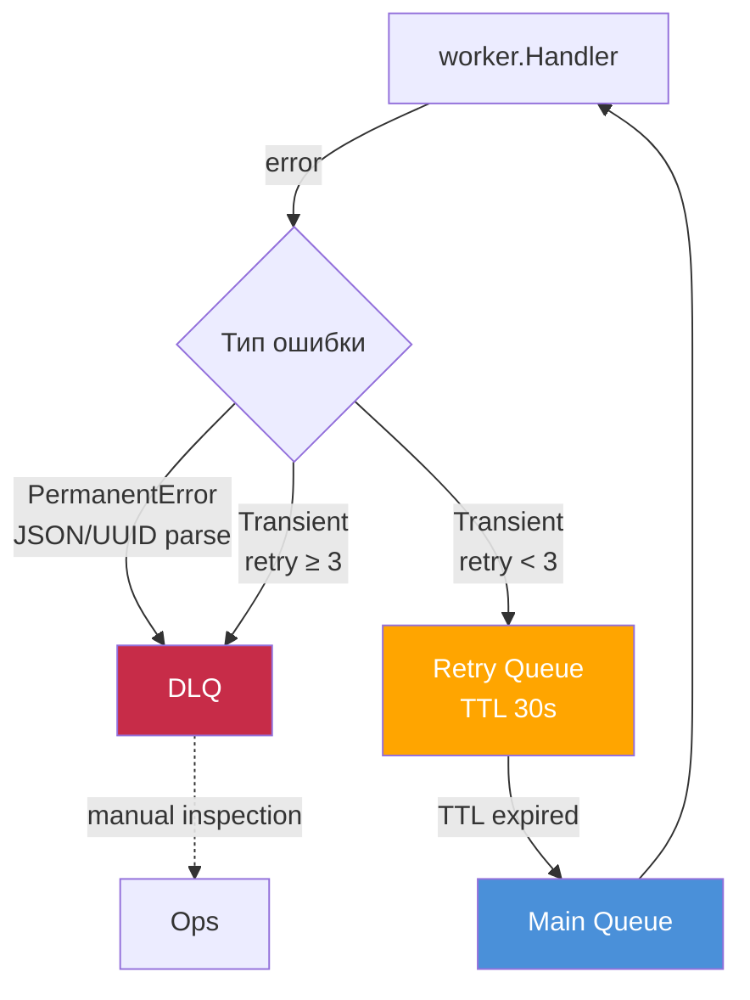

# Шаблонный репозиторий для сервиса "Аватарница"

Это шаблонный репозиторий для выпускной работы по курсу "Go-разработчик". Он содержит базовую структуру проекта, готовую к дальнейшей разработке, а также техническое задание и пример веб-интерфейса.

## Описание

Проект "Аватарница" — это микросервис для управления аватарками пользователей. Он предоставляет REST API для загрузки, получения и удаления изображений, а также простой веб-интерфейс для взаимодействия с сервисом.

## Структура проекта

Проект имеет следующую структуру, основанную на лучших практиках разработки на Go:

```
/
├── cmd/                # Точки входа в приложение (main.go)
│   ├── server/         # HTTP-сервер
│   └── worker/         # Воркер для асинхронной обработки задач
├── internal/           # Внутренняя логика приложения
│   ├── api/            # Спецификации API (OpenAPI/Swagger)
│   ├── config/         # Конфигурация приложения
│   ├── domain/         # Основные доменные сущности
│   ├── handlers/       # HTTP-обработчики
│   ├── repository/     # Работа с хранилищем (БД, S3)
│   ├── services/       # Бизнес-логика
│   └── worker/         # Логика воркера
├── pkg/                # Публичные библиотеки, которые можно использовать в других проектах
├── web/                # Веб-интерфейс
│   └── static/         # Статические файлы (HTML, CSS, JS)
├── migrations/         # Миграции базы данных
├── docker/             # Docker-файлы и конфигурации
├── k8s/                # Манифесты Kubernetes
├── tests/              # Интеграционные и e2e тесты
├── docs/               # Документация проекта
└── .gitignore          # Файл для исключения файлов из Git
```

## Как начать работу

1.  **Клонируйте репозиторий:**
    ```bash
    git clone <URL этого репозитория>
    cd go-avatar-service-template
    ```

2.  **Инициализируйте свой репозиторий на GitHub:**
    Следуйте инструкциям GitHub для создания нового репозитория и свяжите его с этим локальным репозиторием.

3.  **Установите зависимости:**
    ```bash
    go mod tidy
    ```

4.  **Настройте окружение:**
    Создайте файл `.env` на основе `.env.example` (необходимо будет его создать) и укажите необходимые переменные окружения (данные для подключения к БД, S3 и т.д.).

5.  **Запустите сервисы с помощью Docker Compose:**
    ```bash
    docker-compose up --build
    ```

После этого сервис будет доступен по адресу `http://localhost:8080`.

## Запуск через Docker

Весь стек (инфраструктура + приложение) поднимается одной командой:

```bash
make up
```

Под капотом это `docker compose -f docker/docker-compose.yml --env-file .env up -d --build`.
Сервис будет доступен на `http://localhost:8080`, веб-интерфейс — на `http://localhost:8080/web/upload`.

## Архитектура


### Что поднимается

| Сервис | Контейнер | Порты на хосте | Назначение |
|---|---|---|---|
| `postgres` | `gophprofile-postgres` | 5432 | база данных |
| `minio` | `gophprofile-minio` | 9000, 9001 | S3-хранилище (9001 — консоль) |
| `rabbitmq` | `gophprofile-rabbitmq` | 5672, 15672 | брокер (15672 — management UI) |
| `migrate` | `gophprofile-migrate` | — | одноразовый прогон миграций |
| `server` | `gophprofile-server` | 8080 | HTTP API |
| `worker` | `gophprofile-worker` | — | обработка событий (миниатюры, удаление) |


### Как это работает





### Порядок запуска

`server` и `worker` ждут готовности зависимостей, а не просто их старта:
`postgres`, `minio` и `rabbitmq` должны пройти healthcheck, а `migrate` —
успешно завершиться. Поэтому схема БД гарантированно создана до первого запроса.

### Retry / DLQ



### Логика:

1) PermanentError (невалидное сообщение) → сразу DLQ.
2) Transient-ошибка → retry-очередь с TTL 30s → возвращается в main → снова handler.
3) После 3 попыток → DLQ.
4) x-death.count инкрементится при каждом dead-lettering (retry → main).

### Полезные команды

```bash
make up            # поднять весь стек (пересобирает образы)
make up-infra      # только инфраструктура (postgres, minio, rabbitmq)
make build-images  # собрать образы server и worker без запуска
make migrate       # применить миграции вручную
make logs          # логи всех сервисов
make logs-server   # логи server
make logs-worker   # логи worker
make ps            # статус контейнеров
make down          # остановить (данные сохраняются)
make down-v        # остановить и удалить volumes (полная очистка)
```

Проверка состояния приложения:

```bash
curl http://localhost:8080/health
```

`/health` опрашивает БД, S3 и брокер: `200` — всё в порядке, `503` — часть
зависимостей недоступна (в теле ответа видно, какая именно).

### Образы

`Dockerfile` собирает оба бинарника из одного builder-слоя и содержит два
runtime-target'а: `server` (с веб-статикой) и `worker`. Бинарники статические
(`CGO_ENABLED=0`), контейнеры запускаются от непривилегированного пользователя
`app`. Секреты в образ не попадают: `.env` исключён через `.dockerignore`,
значения передаются переменными окружения из `docker-compose.yml`.

### Локальный запуск без Docker

Если инфраструктура уже поднята (`make up-infra`), приложение можно запускать
обычными командами:

```bash
make migrate     # создать схему в БД
make run-server  # go run ./cmd/server
make run-worker  # go run ./cmd/worker (в отдельном терминале)
```

## Веб-интерфейс

Простой одностраничный веб-интерфейс для загрузки аватарок доступен по адресу `http://localhost:8080/web/upload`. Он находится в файле `web/static/index.html`.

**Важно:** Этот интерфейс предоставлен для облегчения старта и демонстрации работы API. Вы можете изменять его, адаптировать под свои нужды или полностью заменить на свой собственный фронтенд.