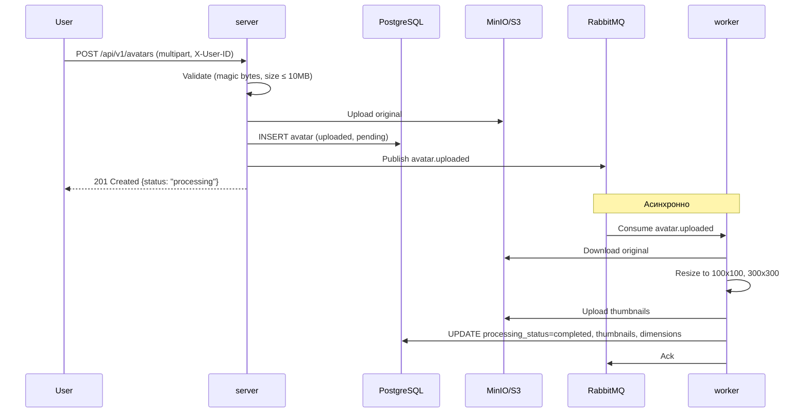
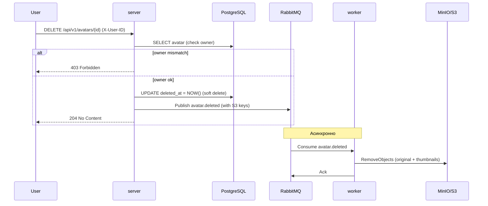
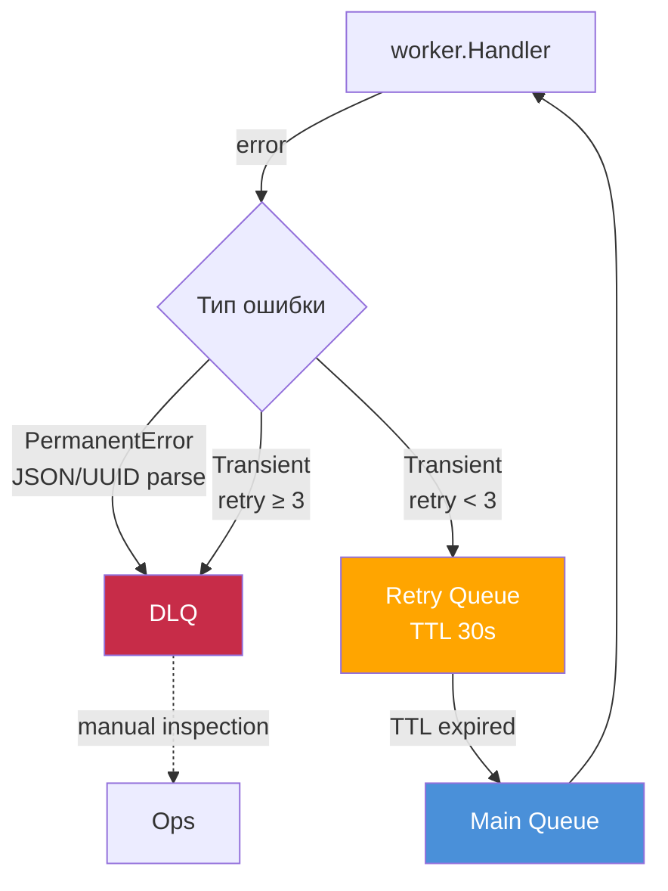

# Шаблонный репозиторий для сервиса "Аватарница"

Это шаблонный репозиторий для выпускной работы по курсу "Go-разработчик". Он содержит базовую структуру проекта, готовую к дальнейшей разработке, а также техническое задание и пример веб-интерфейса.

## Описание

Проект "Аватарница" — это микросервис для управления аватарками пользователей. Он предоставляет REST API для загрузки, получения и удаления изображений, а также простой веб-интерфейс для взаимодействия с сервисом.

## Структура проекта

Проект имеет следующую структуру, основанную на лучших практиках разработки на Go:

```
/
├── cmd/                # Точки входа в приложение (main.go)
│   ├── server/         # HTTP-сервер
│   └── worker/         # Воркер для асинхронной обработки задач
├── internal/           # Внутренняя логика приложения
│   ├── api/            # Спецификации API (OpenAPI/Swagger)
│   ├── config/         # Конфигурация приложения
│   ├── domain/         # Основные доменные сущности
│   ├── handlers/       # HTTP-обработчики
│   ├── migrator/       # Применение миграций при старте (goose)
│   ├── repository/     # Работа с хранилищем (БД, S3)
│   ├── services/       # Бизнес-логика
│   └── worker/         # Логика воркера
├── pkg/                # Публичные библиотеки, которые можно использовать в других проектах
├── web/                # Веб-интерфейс
│   └── static/         # Статические файлы (HTML, CSS, JS)
├── migrations/         # SQL-миграции (goose), встраиваются в бинарник
├── docker/             # Docker-файлы и конфигурации
├── k8s/                # Манифесты Kubernetes
├── helm/               # Helm-чарт приложения (упаковка k8s/)
├── tests/              # Интеграционные и e2e тесты
├── docs/               # Документация проекта
└── .gitignore          # Файл для исключения файлов из Git
```

## Как начать работу

1.  **Клонируйте репозиторий:**
    ```bash
    git clone <URL этого репозитория>
    cd go-avatar-service-template
    ```

2.  **Инициализируйте свой репозиторий на GitHub:**
    Следуйте инструкциям GitHub для создания нового репозитория и свяжите его с этим локальным репозиторием.

3.  **Установите зависимости:**
    ```bash
    go mod tidy
    ```

4.  **Настройте окружение:**
    Создайте файл `.env` на основе `.env.example` (необходимо будет его создать) и укажите необходимые переменные окружения (данные для подключения к БД, S3 и т.д.).

5.  **Запустите сервисы с помощью Docker Compose:**
    ```bash
    docker compose -f docker/docker-compose.yml --env-file .env up -d --build --wait
    ```

После этого сервис будет доступен по адресу `http://localhost:8080`.

## Запуск через Docker

Весь стек (инфраструктура + приложение) поднимается одной командой:

```bash
make up
```

Под капотом это `docker compose -f docker/docker-compose.yml --env-file .env up -d --build`.
Сервис будет доступен на `http://localhost:8080`, веб-интерфейс — на `http://localhost:8080/web/upload`.

## Архитектура


### Что поднимается

| Сервис | Контейнер | Порты на хосте | Назначение |
|---|---|---|---|
| `postgres` | `gophprofile-postgres` | 5432 | база данных |
| `minio` | `gophprofile-minio` | 9000, 9001 | S3-хранилище (9001 — консоль) |
| `rabbitmq` | `gophprofile-rabbitmq` | 5672, 15672, 15692 | брокер (15672 — management UI, 15692 — метрики) |
| `server` | `gophprofile-server` | 8080, 9090 | HTTP API (9090 — `/metrics`) |
| `worker` | `gophprofile-worker` | 9091 | обработка событий (миниатюры, удаление); 9091 — `/metrics` и `/health` |
| `jaeger` | `gophprofile-jaeger` | 16686, 4318 | трейсы (UI и OTLP HTTP) |
| `prometheus` | `gophprofile-prometheus` | 9092 | сбор метрик (9092 — потому что 9090 занят `server`) |
| `grafana` | `gophprofile-grafana` | 3000 | дашборды: метрики + логи + ссылки в трейсы |
| `loki` | `gophprofile-loki` | 3100 | хранилище логов |
| `promtail` | `gophprofile-promtail` | — | сбор логов контейнеров через docker-сокет |


### Как это работает





### Порядок запуска

`server` и `worker` ждут готовности зависимостей, а не просто их старта:
`postgres`, `minio` и `rabbitmq` должны пройти healthcheck. Схему БД каждый
сервис создаёт себе сам при старте: `internal/migrator` применяет встроенные
миграции через goose до того, как приложение начнёт обслуживать запросы.
Поэтому сервис нельзя поднять без нужных таблиц, а отдельный шаг деплоя для
миграций не требуется.

### Миграции

SQL-миграции лежат в `migrations/` в формате goose (`-- +goose Up` /
`-- +goose Down`) и встраиваются в бинарник через `//go:embed`. Применяются
автоматически при старте `server` и `worker`, применённые версии хранятся в
таблице `goose_db_version` — повторный прогон ничего не выполняет заново.

Новая миграция — файл `migrations/NNNN_имя.sql` с аннотациями goose; следующий
запуск приложения применит его сам. Одновременный старт `server` и `worker`
безопасен: goose берёт session-level advisory lock на время прогона.

### Retry / DLQ



### Логика:

1) PermanentError (невалидное сообщение) → сразу DLQ.
2) Transient-ошибка → retry-очередь с TTL 30s → возвращается в main → снова handler.
3) После 3 попыток → DLQ.
4) x-death.count инкрементится при каждом dead-lettering (retry → main).

### Полезные команды

```bash
make up            # поднять весь стек (пересобирает образы)
make up-infra      # только инфраструктура (postgres, minio, rabbitmq)
make up-observ     # только стек наблюдаемости (jaeger, prometheus, grafana, loki, promtail)
make build-images  # собрать образы server и worker без запуска
make logs          # логи всех сервисов
make logs-server   # логи server
make logs-worker   # логи worker
make ps            # статус контейнеров
make down          # остановить (данные сохраняются)
make down-v        # остановить и удалить volumes (полная очистка)
```

Проверка состояния приложения:

```bash
curl http://localhost:8080/health
```

`/health` опрашивает БД, S3 и брокер: `200` — всё в порядке, `503` — часть
зависимостей недоступна (в теле ответа видно, какая именно).

### Образы

`Dockerfile` собирает оба бинарника из одного builder-слоя и содержит два
runtime-target'а: `server` (с веб-статикой) и `worker`. Бинарники статические
(`CGO_ENABLED=0`), контейнеры запускаются от непривилегированного пользователя
`app`. Секреты в образ не попадают: `.env` исключён через `.dockerignore`,
значения передаются переменными окружения из `docker-compose.yml`.

### Локальный запуск без Docker

Если инфраструктура уже поднята (`make up-infra`), приложение можно запускать
обычными командами:

```bash
make run-server  # go run ./cmd/server (миграции применит сам)
make run-worker  # go run ./cmd/worker (в отдельном терминале)
```

## Observability

Стек наблюдаемости поднимается вместе с приложением — это те же сервисы
`docker/docker-compose.yml` (`jaeger`, `prometheus`, `grafana`, `loki`,
`promtail`), отдельных конфигураций и запуска не требуется:

```bash
docker compose -f docker/docker-compose.yml --env-file .env up -d --build --wait
# или: make up  (весь стек)  /  make up-observ  (только стек наблюдаемости)
```

### Доступ

| Сервис | URL | Логин |
|---|---|---|
| Jaeger UI | http://localhost:16686 | — |
| Grafana | http://localhost:3000 | admin / admin |
| Prometheus | http://localhost:9092 | — |
| Loki (API) | http://localhost:3100 | — |
| RabbitMQ UI | http://localhost:15672 | guest / guest |
| RabbitMQ metrics | http://localhost:15692 | — |

Prometheus слушает **9092**, а не 9090: порт 9090 на хосте уже занят
`/metrics` сервера.

Три сигнала:

- **метрики** — Prometheus каждые 15 с скрейпит `server:9090/metrics`,
  `worker:9091/metrics` и `rabbitmq:15692/metrics`;
- **трейсы** — `server` и `worker` шлют спаны по OTLP HTTP на `jaeger:4318`
  (переменная `OTEL_EXPORTER_OTLP_ENDPOINT` в compose);
- **логи** — promtail читает stdout контейнеров `server` и `worker` через
  docker-сокет и пушит их в Loki.

### Трейсинг (Jaeger)

Jaeger UI → **Service**: `gophprofile-server` → **Find Traces**. Один трейс
`POST /api/v1/avatars` содержит всю цепочку, включая асинхронную работу воркера:

```
POST /api/v1/avatars          (gophprofile-server)
  S3.Upload, INSERT, INSERT, RabbitMQ.Publish
RabbitMQ.Consume              (gophprofile-worker)
  SELECT, S3.Download, S3.Upload ×2, UPDATE
```

`RabbitMQ.Publish` и `RabbitMQ.Consume` принадлежат **одному** трейсу: trace
context переносится в заголовках AMQP (W3C `traceparent`), поэтому в Jaeger
виден один сквозной трейс, а не два независимых. То же самое видно по логам:
запись `avatar uploaded` на сервере и `avatar processed` в воркере несут
одинаковый `trace_id`.

### Метрики (Grafana / Prometheus)

Grafana → **Dashboards** → `GophProfile — Overview`: HTTP requests rate,
HTTP request duration p95, avatar uploads rate, логи-ошибки.

Напрямую:

```bash
curl http://localhost:9090/metrics   # server
curl http://localhost:9091/metrics   # worker
```

Что смотреть: `http_requests_total`, `http_request_duration_seconds`
(RED-метрики HTTP) и бизнес-метрики `avatars_uploads_total`,
`avatars_upload_duration_seconds`, `avatars_deletes_total`,
`avatars_storage_bytes`, `avatars_file_size_bytes`,
`avatars_processing_duration_seconds`.

### Метрики RabbitMQ

Инфраструктурные метрики отдаёт сам брокер — плагин `rabbitmq_prometheus`
(включён в образ `-management`, порт 15692); Prometheus скрейпит джобом
`rabbitmq`:

```bash
curl http://localhost:15692/metrics | grep rabbitmq_queue_messages
```

Глубина очередей: `rabbitmq_queue_messages_ready` (ждут доставки),
`rabbitmq_queue_messages_unacked` (доставлены, но не подтверждены),
`rabbitmq_queue_consumers` (число потребителей). Рост `_ready` при нуле
`_consumers` означает, что воркер не разбирает очередь.

Значения агрегированы по всем очередям (main, retry, DLQ): по умолчанию
RabbitMQ не отдаёт метрики по объектам, чтобы не раздувать кардинальность.
Разрез по очередям включается настройкой `prometheus.return_per_object_metrics`
в `rabbitmq.conf`, если понадобится видеть конкретную забитую очередь.

### Логи (Loki)

Grafana → **Explore** → Loki:

```logql
{service="server"} |= "error"
{service="server"} | json | trace_id="1f0bdeedd8637f6caa1bced5c54388ad"
```

Приложение пишет JSON-логи (slog), а поля `trace_id` и `span_id` подставляются
автоматически из активного спана. В Loki у `trace_id` настроен derived field,
ведущий в Jaeger: клик по значению открывает тот же трейс — так лог и трейс
связываются без ручного поиска.

### `/health` и трейсы

`/health` намеренно исключён из трейсов (`otelhttp.WithFilter`): Docker
healthcheck обращается к нему каждые 15 секунд, и Jaeger заполнялся бы мусором.
В метриках (`http_requests_total{path="/health"}`) `/health` при этом остаётся.

### Семантические конвенции OTel

Спаны размечены **актуальными** атрибутами OTel semconv, а не устаревшими
именами из ТЗ: `db.system.name` (= `postgresql`), `db.query.text` (шаблон
запроса с плейсхолдерами — значения параметров в трейсы не попадают),
`aws.s3.bucket` / `aws.s3.key`, `messaging.system` (= `rabbitmq`),
`messaging.destination.name`, `messaging.rabbitmq.destination.routing_key`,
`messaging.message.id`.

## Kubernetes — Helm

Чарт `helm/gophprofile` упаковывает тот же стек, что лежит в `k8s/` сырыми
манифестами (сами манифесты оставлены для сравнения и для отладки без Helm).
Namespace в чарт не входит — используется `--create-namespace`; ServiceMonitor
по умолчанию выключен (`serviceMonitor.enabled: false`), потому что в локальном
кластере нет CRD Prometheus Operator.

```bash
# Установка: создаёт объекты, затем выполняет хук миграций
helm install gophprofile ./helm/gophprofile -n gophprofile --create-namespace

# Обновление: хук миграций отрабатывает до обновления подов приложения
helm upgrade gophprofile ./helm/gophprofile -n gophprofile

# Окружения
helm install gophprofile ./helm/gophprofile -n gophprofile --create-namespace \
  -f helm/gophprofile/values-dev.yaml     # 1 под сервера, без HPA
helm upgrade gophprofile ./helm/gophprofile -n gophprofile \
  -f helm/gophprofile/values-prod.yaml    # 3 пода, HPA до 20, ServiceMonitor, внешний домен

# Удаление (PVC при этом остаются — см. ниже)
helm uninstall gophprofile -n gophprofile

# Проверка
helm lint ./helm/gophprofile
helm template gophprofile ./helm/gophprofile -n gophprofile
helm list -n gophprofile
```

### Что в чарте

| Шаблон | Объекты |
|---|---|
| `secret.yaml`, `configmap.yaml` | учётные данные и несекретная конфигурация |
| `10-postgres.yaml`, `11-minio.yaml`, `12-rabbitmq.yaml` | StatefulSet + headless Service + PVC |
| `20-server.yaml`, `21-worker.yaml` | Deployment + Service |
| `30-ingress.yaml` | Ingress (гасится `ingress.enabled`) |
| `40-hpa.yaml` | HPA (гасится `hpa.enabled`) |
| `50-servicemonitor.yaml` | ServiceMonitor'ы (`serviceMonitor.enabled`, по умолчанию `false`) |
| `60-serviceaccount.yaml`, `61-networkpolicy.yaml` | ServiceAccount'ы и сетевая сегментация |
| `70-migration-job.yaml` | Job миграций (Helm-хук) |

Основные ручки — в `values.yaml`: образы и число реплик (`server`, `worker`),
ресурсы и размеры томов (`postgres`, `minio`, `rabbitmq`), `ingress.*`,
`hpa.*`, `serviceMonitor.*`, `config.*` и `secrets.*`. Имена объектов
(`server`, `postgres`, `gophprofile-secrets`, …) зафиксированы, а не собраны из
имени релиза: на них ссылаются переменные окружения приложения
(`POSTGRES_HOST=postgres`, `S3_ENDPOINT=minio:9000`) и селекторы NetworkPolicy,
поэтому чарт рассчитан на один релиз в namespace.

### Хук миграций

`Job gophprofile-migrate` запускает тот же образ, что у сервера, с
`MIGRATE_ONLY=true`: `cmd/server/main.go` в этом режиме подключается к БД,
применяет миграции и завершается, не поднимая HTTP-сервер, `/metrics` и трейсинг.

Хук повешен на **`post-install,pre-upgrade`**, а не на `pre-install,pre-upgrade`:

- на первом `install` у `pre-install` хука не существует ни ServiceAccount, ни
  ConfigMap, ни Secret, ни Service `postgres` — их создаёт сам релиз уже после
  хуков. Проверено: Job падал с `pods "gophprofile-migrate-" is forbidden:
  error looking up service account gophprofile/gophprofile-sa: serviceaccount
  "gophprofile-sa" not found`, а `helm install` завершался ошибкой по таймауту
  хука (5 минут);
- `post-install` выполняется после создания объектов релиза, поэтому
  initContainer Job'а успевает дождаться `postgres:5432`, а `envFrom` — найти
  ConfigMap и Secret;
- на `upgrade` порядок остаётся правильным: `pre-upgrade` отрабатывает до
  обновления подов приложения.

Повторный запуск безопасен: goose пропускает уже применённые миграции (в логе
upgrade'а нет ни одного `migration applied`). Проверено на живом кластере:
install — хук `Succeeded` за 14 секунд, upgrade — состав подов и счётчики
рестартов не изменились.

Под миграции тоже покрыт сетевой политикой (`migration-egress`): ему разрешены
только PostgreSQL и DNS — как серверу и воркеру. Без этого правила Job не смог
бы подключиться к БД, потому что `postgres-ingress` пускает лишь поды с
метками `app: server` / `app: worker`.

### Удаление

`helm uninstall` удаляет все объекты релиза, но **не** PVC: тома
`data-postgres-0`, `data-minio-0`, `data-rabbitmq-0` остаются, и данные
переживают переустановку. Если тома больше не нужны:

```bash
kubectl delete pvc --all -n gophprofile
```

Чарт проверен на Helm v3.16.4: `helm lint` и `helm template` проходят для
дефолтных, dev- и prod-значений (22, 21 и 25 объектов соответственно).

## Kubernetes — мониторинг (ServiceMonitor)

`k8s/50-servicemonitor.yaml` — **артефакт для Prometheus Operator**, в локальном
кластере он не применяется. В Helm-чарте тот же объект выключен по умолчанию
(`serviceMonitor.enabled: false`) и включается в проде — см. раздел
«Kubernetes — Helm». Манифест описан в терминах CRD
`monitoring.coreos.com/v1`, которых в minikube нет: полный
`kube-prometheus-stack` требует 2–3 GB RAM, а у ноды 6 GB, из которых ~1.5 GB
занимают приложение и инфраструктура. Поэтому файл лежит в репозитории как
готовый к продакшену объект (для ревьюера), а не как часть рабочего стенда.

В проде:

```bash
# 1. Стек оператора
helm repo add prometheus-community https://prometheus-community.github.io/helm-charts
helm install kube-prometheus-stack prometheus-community/kube-prometheus-stack \
  -n monitoring --create-namespace

# 2. ServiceMonitor'ы для server и worker
kubectl apply -f k8s/50-servicemonitor.yaml
# (или через чарт: helm upgrade gophprofile ./helm/gophprofile -n gophprofile \
#    --set serviceMonitor.enabled=true)

# 3. Проверка: Prometheus → Status → Targets (или)
kubectl get servicemonitor -n gophprofile
```

Дальше Prometheus обнаруживает поды `server` и `worker` сам и скрейпит
`/metrics` каждые 30 секунд — без правок scrape-конфига и перезапуска
Prometheus.

Что важно в манифесте:

- `selector.matchLabels: app: server` / `app: worker` — ServiceMonitor выбирает
  не поды, а Service, поэтому метки должны быть на Service (они есть в
  `k8s/20-server.yaml` и `k8s/21-worker.yaml`);
- `endpoints.port: metrics` — **именованный** порт Service (`- name: metrics,
  port: 9090` у server, `9091` у worker): при смене номера порта джоба не
  развалится;
- `labels.release: kube-prometheus-stack` — селектор Prometheus из
  kube-prometheus-stack по умолчанию берёт только ServiceMonitor с меткой
  `release`, равной имени helm-релиза. Если релиз назван иначе — поправить.

Метрики (добавлены в iter2) отдаются на `/metrics`: `:9090` у server,
`:9091` у worker — те же, что собираются в Docker-стенде. Пока оператора нет,
в локальном кластере метрики снимаются вручную:

```bash
kubectl port-forward -n gophprofile svc/server 9090:9090
curl http://localhost:9090/metrics
```

## Kubernetes — безопасность (NetworkPolicy, SecurityContext, ServiceAccount)

Деплой в кластер (все манифесты, кроме `50-servicemonitor.yaml`: для него нужен
Prometheus Operator):

```bash
kubectl apply -f k8s/00-namespace.yaml -f k8s/01-secret.yaml -f k8s/02-configmap.yaml \
  -f k8s/10-postgres.yaml -f k8s/11-minio.yaml -f k8s/12-rabbitmq.yaml \
  -f k8s/20-server.yaml -f k8s/21-worker.yaml -f k8s/30-ingress.yaml \
  -f k8s/40-hpa.yaml -f k8s/60-serviceaccount.yaml -f k8s/61-networkpolicy.yaml
```

Тот же набор объектов ставится одной командой через Helm — см. раздел
«Kubernetes — Helm».

### ServiceAccount

`k8s/60-serviceaccount.yaml` — два SA (`gophprofile-sa` для server/worker,
`gophprofile-db-sa` для postgres/minio/rabbitmq), оба с
`automountServiceAccountToken: false`: приложению Kubernetes API не нужен, и
токен в поды не монтируется. RBAC (Role/RoleBinding) не добавляется намеренно —
без токена под не может обращаться к API, а «пустая» роль создавала бы лишь
видимость прав.

### NetworkPolicy

`k8s/61-networkpolicy.yaml` — пять политик по схеме «default deny + явные
разрешения»:

| Под | Входящий | Исходящий |
|---|---|---|
| `server` | `ingress-nginx` → 8080 | postgres:5432, minio:9000, rabbitmq:5672, DNS (kube-system:53) |
| `worker` | любой источник → 9091 (метрики) | то же, что у server |
| `postgres` / `minio` / `rabbitmq` | только от `server` и `worker` | не ограничен (политика задаёт только Ingress) |

DNS разрешён только к `kube-system:53` (UDP и TCP) — внешние резолверы
приложению не нужны.

Проверено на живом кластере (CNI kindnet в minikube v1.39 политики
**действительно применяет**):

```bash
# под в другом namespace не достучится до server
kubectl run probe --rm -it --image=busybox:1.36 -n default -- \
  nc -w 3 -z server.gophprofile.svc.cluster.local 8080     # rc=1 — отказ
# под с меткой app=worker достучится до postgres, но не до server
kubectl run probe --rm -it --image=busybox:1.36 -n gophprofile --labels=app=worker -- \
  nc -w 3 -z postgres 5432                                  # rc=0 — доступ есть
```

### SecurityContext

- **server / worker** — `runAsNonRoot: true`, `runAsUser/runAsGroup: 1000`,
  `allowPrivilegeEscalation: false`, `readOnlyRootFilesystem: true`,
  `capabilities.drop: [ALL]`. UID задан явно, а не унаследован из образа (там
  `app` = uid 100): важно не конкретное число, а непривилегированность.
  `readOnlyRootFilesystem` проверен на работающем приложении: файловых операций
  у него нет (картинки обрабатываются в памяти, всё остальное — S3 и PostgreSQL),
  `touch /app/probe` и `touch /tmp/probe` внутри пода отвечают
  `Read-only file system`, при этом загрузка, обработка, выдача и удаление
  аватарок работают.
- **postgres / rabbitmq** — `fsGroup: 1000`, `allowPrivilegeEscalation: false`,
  `capabilities.drop: [ALL]` плюс минимальный возврат (`CHOWN`, `DAC_OVERRIDE`,
  `FOWNER`, `SETGID`, `SETUID`). Полный drop у этих образов не работает:
  entrypoint'ы стартуют от root, готовят том (`chmod`/`chown`) и лишь затем
  сбрасывают привилегии через `gosu`/`su-exec` — без этих капабилити поды уходят
  в CrashLoopBackOff (подробности в `docs/tech-debt.md`).
- **minio** — `fsGroup: 1000`, `allowPrivilegeEscalation: false`, полный
  `capabilities.drop: [ALL]`: этот образ привилегий не сбрасывает и внутри
  контейнера остаётся root.
- `readOnlyRootFilesystem` для БД и брокера не включается: они пишут не только в
  том, но и во временные каталоги.

## Веб-интерфейс

Простой одностраничный веб-интерфейс для загрузки аватарок доступен по адресу `http://localhost:8080/web/upload`. Он находится в файле `web/static/index.html`.

**Важно:** Этот интерфейс предоставлен для облегчения старта и демонстрации работы API. Вы можете изменять его, адаптировать под свои нужды или полностью заменить на свой собственный фронтенд.