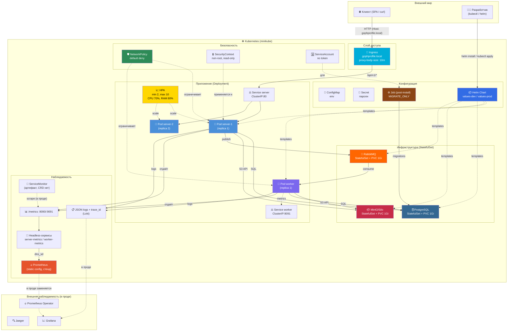

# Шаблонный репозиторий для сервиса "Аватарница"

Это шаблонный репозиторий для выпускной работы по курсу "Go-разработчик". Он содержит базовую структуру проекта, готовую к дальнейшей разработке, а также техническое задание и пример веб-интерфейса.

## Описание

Проект "Аватарница" — это микросервис для управления аватарками пользователей. Он предоставляет REST API для загрузки, получения и удаления изображений, а также простой веб-интерфейс для взаимодействия с сервисом.

Подробнее об устройстве сервиса, потоках запросов и Kubernetes-архитектуре —
[docs/architecture.md](docs/architecture.md). Спецификация HTTP API —
[docs/openapi.yaml](docs/openapi.yaml).

или просто посмотрите на эту схему



## Структура проекта

Проект имеет следующую структуру, основанную на лучших практиках разработки на Go:

```
/
├── cmd/                # Точки входа в приложение (main.go)
│   ├── server/         # HTTP-сервер
│   └── worker/         # Воркер для асинхронной обработки задач
├── internal/           # Внутренняя логика приложения
│   ├── api/            # Спецификации API (OpenAPI/Swagger)
│   ├── config/         # Конфигурация приложения
│   ├── domain/         # Основные доменные сущности
│   ├── handlers/       # HTTP-обработчики
│   ├── migrator/       # Применение миграций при старте (goose)
│   ├── repository/     # Работа с хранилищем (БД, S3)
│   ├── services/       # Бизнес-логика
│   └── worker/         # Логика воркера
├── pkg/                # Публичные библиотеки, которые можно использовать в других проектах
├── web/                # Веб-интерфейс
│   └── static/         # Статические файлы (HTML, CSS, JS)
├── migrations/         # SQL-миграции (goose), встраиваются в бинарник
├── docker/             # Docker-файлы и конфигурации
├── k8s/                # Манифесты Kubernetes
├── helm/               # Helm-чарт приложения (упаковка k8s/)
├── tests/              # Интеграционные и e2e тесты
├── docs/               # Документация проекта
└── .gitignore          # Файл для исключения файлов из Git
```

## Как начать работу

1.  **Клонируйте репозиторий:**
    ```bash
    git clone <URL этого репозитория>
    cd go-avatar-service-template
    ```

2.  **Инициализируйте свой репозиторий на GitHub:**
    Следуйте инструкциям GitHub для создания нового репозитория и свяжите его с этим локальным репозиторием.

3.  **Установите зависимости:**
    ```bash
    go mod tidy
    ```

4.  **Настройте окружение:**
    Создайте файл `.env` на основе `.env.example` (необходимо будет его создать) и укажите необходимые переменные окружения (данные для подключения к БД, S3 и т.д.).

5.  **Запустите сервисы с помощью Docker Compose:**
    ```bash
    docker compose -f docker/docker-compose.yml --env-file .env up -d --build --wait
    ```

После этого сервис будет доступен по адресу `http://localhost:8080`.

## Запуск через Docker

Весь стек (инфраструктура + приложение) поднимается одной командой:

```bash
make up
```

Под капотом это `docker compose -f docker/docker-compose.yml --env-file .env up -d --build`.
Сервис будет доступен на `http://localhost:8080`, веб-интерфейс — на `http://localhost:8080/web/upload`.


### Что поднимается

| Сервис | Контейнер | Порты на хосте | Назначение |
|---|---|---|---|
| `postgres` | `gophprofile-postgres` | 5432 | база данных |
| `minio` | `gophprofile-minio` | 9000, 9001 | S3-хранилище (9001 — консоль) |
| `rabbitmq` | `gophprofile-rabbitmq` | 5672, 15672, 15692 | брокер (15672 — management UI, 15692 — метрики) |
| `server` | `gophprofile-server` | 8080, 9090 | HTTP API (9090 — `/metrics`) |
| `worker` | `gophprofile-worker` | 9091 | обработка событий (миниатюры, удаление); 9091 — `/metrics` и `/health` |
| `jaeger` | `gophprofile-jaeger` | 16686, 4318 | трейсы (UI и OTLP HTTP) |
| `prometheus` | `gophprofile-prometheus` | 9092 | сбор метрик (9092 — потому что 9090 занят `server`) |
| `grafana` | `gophprofile-grafana` | 3000 | дашборды: метрики + логи + ссылки в трейсы |
| `loki` | `gophprofile-loki` | 3100 | хранилище логов |
| `promtail` | `gophprofile-promtail` | — | сбор логов контейнеров через docker-сокет |


### Порядок запуска

`server` и `worker` ждут готовности зависимостей, а не просто их старта:
`postgres`, `minio` и `rabbitmq` должны пройти healthcheck. Схему БД каждый
сервис создаёт себе сам при старте: `internal/migrator` применяет встроенные
миграции через goose до того, как приложение начнёт обслуживать запросы.
Поэтому сервис нельзя поднять без нужных таблиц, а отдельный шаг деплоя для
миграций не требуется.

### Миграции

SQL-миграции лежат в `migrations/` в формате goose (`-- +goose Up` /
`-- +goose Down`) и встраиваются в бинарник через `//go:embed`. Применяются
автоматически при старте `server` и `worker`, применённые версии хранятся в
таблице `goose_db_version` — повторный прогон ничего не выполняет заново.

Новая миграция — файл `migrations/NNNN_имя.sql` с аннотациями goose; следующий
запуск приложения применит его сам. Одновременный старт `server` и `worker`
безопасен: goose берёт session-level advisory lock на время прогона.

### Логика:

1) PermanentError (невалидное сообщение) → сразу DLQ.
2) Transient-ошибка → retry-очередь с TTL 30s → возвращается в main → снова handler.
3) После 3 попыток → DLQ.
4) x-death.count инкрементится при каждом dead-lettering (retry → main).

### Полезные команды

```bash
make up            # поднять весь стек (пересобирает образы)
make up-infra      # только инфраструктура (postgres, minio, rabbitmq)
make up-observ     # только стек наблюдаемости (jaeger, prometheus, grafana, loki, promtail)
make build-images  # собрать образы server и worker без запуска
make logs          # логи всех сервисов
make logs-server   # логи server
make logs-worker   # логи worker
make ps            # статус контейнеров
make down          # остановить (данные сохраняются)
make down-v        # остановить и удалить volumes (полная очистка)
```

Проверка состояния приложения:

```bash
curl http://localhost:8080/health   # состояние зависимостей: 200 | 503
curl http://localhost:8080/live     # процесс жив: всегда 200 {"status":"ok"}
```

`/health` опрашивает БД, S3 и брокер: `200` — всё в порядке, `503` — часть
зависимостей недоступна (в теле ответа видно, какая именно). `/live` ничего не
проверяет и отвечает мгновенно — он отвечает на другой вопрос (см.
«Liveness и readiness» в разделе про production-готовность).

### Образы

`Dockerfile` собирает оба бинарника из одного builder-слоя и содержит два
runtime-target'а: `server` (с веб-статикой) и `worker`. Бинарники статические
(`CGO_ENABLED=0`), контейнеры запускаются от непривилегированного пользователя
`app`. Секреты в образ не попадают: `.env` исключён через `.dockerignore`,
значения передаются переменными окружения из `docker-compose.yml`.

### Локальный запуск без Docker

Если инфраструктура уже поднята (`make up-infra`), приложение можно запускать
обычными командами:

```bash
make run-server  # go run ./cmd/server (миграции применит сам)
make run-worker  # go run ./cmd/worker (в отдельном терминале)
```

## Observability

Стек наблюдаемости поднимается вместе с приложением — это те же сервисы
`docker/docker-compose.yml` (`jaeger`, `prometheus`, `grafana`, `loki`,
`promtail`), отдельных конфигураций и запуска не требуется:

```bash
docker compose -f docker/docker-compose.yml --env-file .env up -d --build --wait
# или: make up  (весь стек)  /  make up-observ  (только стек наблюдаемости)
```

### Доступ

| Сервис | URL | Логин |
|---|---|---|
| Jaeger UI | http://localhost:16686 | — |
| Grafana | http://localhost:3000 | admin / admin |
| Prometheus | http://localhost:9092 | — |
| Loki (API) | http://localhost:3100 | — |
| RabbitMQ UI | http://localhost:15672 | guest / guest |
| RabbitMQ metrics | http://localhost:15692 | — |

Prometheus слушает **9092**, а не 9090: порт 9090 на хосте уже занят
`/metrics` сервера.

Три сигнала:

- **метрики** — Prometheus каждые 15 с скрейпит `server:9090/metrics`,
  `worker:9091/metrics` и `rabbitmq:15692/metrics`;
- **трейсы** — `server` и `worker` шлют спаны по OTLP HTTP на `jaeger:4318`
  (переменная `OTEL_EXPORTER_OTLP_ENDPOINT` в compose);
- **логи** — promtail читает stdout контейнеров `server` и `worker` через
  docker-сокет и пушит их в Loki.

В Kubernetes эти же сигналы сохраняются: метрики отдаются на `:9090` (server) и
`:9091` (worker), трейсы уходят по OTLP на Jaeger, логи остаются JSON с
`trace_id`. В локальном кластере метрики собирает Prometheus из чарта
(`prometheus.enabled: true`) через headless-сервисы `server-metrics` и
`worker-metrics`; в проде тот же сбор описывают ServiceMonitor'ы для
Prometheus Operator. Подробности — в разделе «Kubernetes — мониторинг».

### Трейсинг (Jaeger)

Jaeger UI → **Service**: `gophprofile-server` → **Find Traces**. Один трейс
`POST /api/v1/avatars` содержит всю цепочку, включая асинхронную работу воркера:

```
POST /api/v1/avatars          (gophprofile-server)
  S3.Upload, INSERT, INSERT, RabbitMQ.Publish
RabbitMQ.Consume              (gophprofile-worker)
  SELECT, S3.Download, S3.Upload ×2, UPDATE
```

`RabbitMQ.Publish` и `RabbitMQ.Consume` принадлежат **одному** трейсу: trace
context переносится в заголовках AMQP (W3C `traceparent`), поэтому в Jaeger
виден один сквозной трейс, а не два независимых. То же самое видно по логам:
запись `avatar uploaded` на сервере и `avatar processed` в воркере несут
одинаковый `trace_id`.

### Метрики (Grafana / Prometheus)

Grafana → **Dashboards** → `GophProfile — Overview`: HTTP requests rate,
HTTP request duration p95, avatar uploads rate, логи-ошибки.

Напрямую:

```bash
curl http://localhost:9090/metrics   # server
curl http://localhost:9091/metrics   # worker
```

Что смотреть: `http_requests_total`, `http_request_duration_seconds`
(RED-метрики HTTP) и бизнес-метрики `avatars_uploads_total`,
`avatars_upload_duration_seconds`, `avatars_deletes_total`,
`avatars_storage_bytes`, `avatars_file_size_bytes`,
`avatars_processing_duration_seconds`.

### Метрики RabbitMQ

Инфраструктурные метрики отдаёт сам брокер — плагин `rabbitmq_prometheus`
(включён в образ `-management`, порт 15692); Prometheus скрейпит джобом
`rabbitmq`:

```bash
curl http://localhost:15692/metrics | grep rabbitmq_queue_messages
```

Глубина очередей: `rabbitmq_queue_messages_ready` (ждут доставки),
`rabbitmq_queue_messages_unacked` (доставлены, но не подтверждены),
`rabbitmq_queue_consumers` (число потребителей). Рост `_ready` при нуле
`_consumers` означает, что воркер не разбирает очередь.

Значения агрегированы по всем очередям (main, retry, DLQ): по умолчанию
RabbitMQ не отдаёт метрики по объектам, чтобы не раздувать кардинальность.
Разрез по очередям включается настройкой `prometheus.return_per_object_metrics`
в `rabbitmq.conf`, если понадобится видеть конкретную забитую очередь.

### Логи (Loki)

Grafana → **Explore** → Loki:

```logql
{service="server"} |= "error"
{service="server"} | json | trace_id="1f0bdeedd8637f6caa1bced5c54388ad"
```

Приложение пишет JSON-логи (slog), а поля `trace_id` и `span_id` подставляются
автоматически из активного спана. В Loki у `trace_id` настроен derived field,
ведущий в Jaeger: клик по значению открывает тот же трейс — так лог и трейс
связываются без ручного поиска.

### Служебные эндпоинты и трейсы

`/health` и `/live` намеренно исключены из трейсов (`otelhttp.WithFilter` по
`isServicePath`): kubelet обращается к ним каждые 5–15 секунд, и Jaeger
заполнялся бы мусором. В метриках (`http_requests_total{path="/health"}`) они при
этом остаются. Те же пути исключены из rate limit — иначе 429 на `/live` означал
бы перезапуск здорового пода при всплеске трафика.

### Семантические конвенции OTel

Спаны размечены **актуальными** атрибутами OTel semconv, а не устаревшими
именами из ТЗ: `db.system.name` (= `postgresql`), `db.query.text` (шаблон
запроса с плейсхолдерами — значения параметров в трейсы не попадают),
`aws.s3.bucket` / `aws.s3.key`, `messaging.system` (= `rabbitmq`),
`messaging.destination.name`, `messaging.rabbitmq.destination.routing_key`,
`messaging.message.id`.

## Запуск в Kubernetes

Ниже — минимальный путь от исходников до работающего стенда в minikube.
Детали чарта, окружений и хука миграций — в следующем разделе.

### Требования

- Docker и minikube (проверено на minikube v1.39, Kubernetes v1.37);
- `kubectl` и Helm 3.x (проверено на Helm v3.16.4);
- включённый ingress-контроллер: `minikube addons enable ingress`;
- не менее ~4 GB RAM для ноды: приложение и инфраструктура занимают ~1.5 GB,
  остальное нужно minikube и ingress-nginx;
- внешний registry не требуется — образы собираются локально и загружаются
  в кластер.

### Сборка и загрузка образов

`Dockerfile` содержит два runtime-target'а — `server` (HTTP API и веб-статика)
и `worker` (асинхронная обработка). Оба бинарника собираются из одного
builder-слоя:

```bash
docker build --target server -t gophprofile-server:latest .
docker build --target worker -t gophprofile-worker:latest .

minikube image load gophprofile-server:latest
minikube image load gophprofile-worker:latest
```

Имена образов совпадают с `server.image.repository` и `worker.image.repository`
в `helm/gophprofile/values.yaml`. При `imagePullPolicy: IfNotPresent` кластер
берёт локально загруженные образы и не ходит в Docker Hub.

### Установка

```bash
helm install gophprofile ./helm/gophprofile -n gophprofile --create-namespace
```

Чарт создаёт PostgreSQL, MinIO, RabbitMQ, Deployment'ы `server` и `worker`,
Service'ы, Ingress, HPA, ServiceAccount'ы, NetworkPolicy и Prometheus для
локального сбора метрик. Job миграций — `post-install` хук: он запускается
после создания объектов релиза, применяет схему и удаляется после успеха
(`hook-delete-policy: hook-succeeded`), поэтому в `kubectl get jobs` его обычно
уже нет.

Учётные данные по умолчанию берутся из `secrets.*` в `values.yaml`, и чарт
создаёт из них Secret `gophprofile-secrets`. Чтобы Secret'ом управлял не Helm,
а внешняя система (Vault, External Secrets, SOPS), задайте его имя:

```bash
helm install gophprofile ./helm/gophprofile -n gophprofile --create-namespace \
  --set secrets.existingSecret=gophprofile-secrets-external
```

В этом режиме `templates/secret.yaml` не рендерится, а все потребители
(`server`, `worker`, Job миграций, PostgreSQL, MinIO, RabbitMQ) ссылаются на
существующий объект через helper `gophprofile.secretName`. Контракт внешнего
Secret — 10 ключей: `POSTGRES_USER`, `POSTGRES_PASSWORD`, `POSTGRES_DB`,
`MINIO_ROOT_USER`, `MINIO_ROOT_PASSWORD`, `S3_ACCESS_KEY`, `S3_SECRET_KEY`,
`RABBITMQ_DEFAULT_USER`, `RABBITMQ_DEFAULT_PASS`, `RABBITMQ_URL`. Последний
ключ обязателен: при внешнем Secret пароль брокера не читается из values,
поэтому URL `amqp://...` приходит только из Secret. В `values-prod.yaml`
`secrets.existingSecret` уже включён.

Смена режима Secret на уже установленном релизе требует `--no-hooks`:
`pre-upgrade` хук миграций выполняется до применения объектов новой ревизии и
читает Secret предыдущей, поэтому при переходе «чарт → внешний Secret» Job
падает с `CreateContainerConfigError` (см. `docs/tech-debt.md`).

Проверка:

```bash
kubectl get pods -n gophprofile
kubectl get ingress -n gophprofile
helm status gophprofile -n gophprofile
```

Ожидаемое состояние — все поды `Running`/`Ready`, `server` в двух репликах
(значение по умолчанию), HPA видит метрики и не упирается в ошибки.

### Доступ к сервису

Через Ingress (хост из `ingress.host`, по умолчанию `gophprofile.local`).
В minikube ingress-контроллер обычно опубликован как NodePort:

```bash
NODE_PORT=$(kubectl -n ingress-nginx get svc ingress-nginx-controller \
  -o jsonpath='{.spec.ports[?(@.name=="http")].nodePort}')
curl -H 'Host: gophprofile.local' "http://$(minikube ip):${NODE_PORT}/health"
```

Если DNS-имя не резолвится, добавьте его в `hosts` или используйте
`curl --resolve gophprofile.local:${NODE_PORT}:$(minikube ip)`. На Windows/WSL
адрес ноды и способ проброса зависят от драйвера minikube; альтернатива для
отладки — port-forward (он идёт через API-сервер и не проверяет
Ingress/NetworkPolicy):

```bash
kubectl port-forward -n gophprofile svc/server 8080:80
curl http://localhost:8080/health
```

### Сквозной сценарий

```bash
# 1. Загрузка: multipart-поле image, пользователь — в X-User-ID
curl -s -X POST http://localhost:8080/api/v1/avatars \
  -H 'X-User-ID: demo-user' \
  -F 'image=@/path/to/avatar.png'
# → 201 {"id":"...","status":"processing",...}

# 2. Метаданные: воркер асинхронно создаёт миниатюры,
#    processing_status меняется с processing на completed
curl -s http://localhost:8080/api/v1/avatars/<id>

# 3. Готовая миниатюра (size: original | 100x100 | 300x300)
curl -s -o /tmp/thumb.png -w '%{http_code}\n' \
  'http://localhost:8080/api/v1/avatars/<id>/content?size=100x100'

# 4. Удаление (204; оригинал и миниатюры удаляются воркером)
curl -s -o /dev/null -w '%{http_code}\n' -X DELETE \
  http://localhost:8080/api/v1/avatars/<id> -H 'X-User-ID: demo-user'

# 5. Пробы
curl -s http://localhost:8080/live     # {"status":"ok"}
curl -s http://localhost:8080/health   # 200 или 503 с причиной
```

Логи и состояние:

```bash
kubectl logs -n gophprofile deploy/server -f
kubectl logs -n gophprofile deploy/worker -f
kubectl get hpa -n gophprofile
```

## Kubernetes — Helm

Чарт `helm/gophprofile` упаковывает тот же стек, что лежит в `k8s/` сырыми
манифестами (сами манифесты оставлены для сравнения и для отладки без Helm).
Namespace в чарт не входит — используется `--create-namespace`; ServiceMonitor
по умолчанию выключен (`serviceMonitor.enabled: false`), потому что в локальном
кластере нет CRD Prometheus Operator. Вместо него метрики собирает встроенный
Prometheus со static config (`prometheus.enabled: true`) — см. раздел
«Kubernetes — мониторинг».

```bash
# Установка: создаёт объекты, затем выполняет хук миграций
helm install gophprofile ./helm/gophprofile -n gophprofile --create-namespace

# Обновление: хук миграций отрабатывает до обновления подов приложения
helm upgrade gophprofile ./helm/gophprofile -n gophprofile

# Окружения
helm install gophprofile ./helm/gophprofile -n gophprofile --create-namespace \
  -f helm/gophprofile/values-dev.yaml     # 1 под сервера, без HPA
helm upgrade gophprofile ./helm/gophprofile -n gophprofile \
  -f helm/gophprofile/values-prod.yaml    # 3 пода, HPA до 20, ServiceMonitor, внешний Secret, внешний домен

# Удаление (PVC при этом остаются — см. ниже)
helm uninstall gophprofile -n gophprofile

# Проверка
helm lint ./helm/gophprofile
helm template gophprofile ./helm/gophprofile -n gophprofile
helm list -n gophprofile
```

### Что в чарте

| Шаблон | Объекты |
|---|---|
| `secret.yaml`, `configmap.yaml` | учётные данные и несекретная конфигурация; при `secrets.existingSecret` Secret не создаётся |
| `10-postgres.yaml`, `11-minio.yaml`, `12-rabbitmq.yaml` | StatefulSet + headless Service + PVC |
| `20-server.yaml`, `21-worker.yaml` | Deployment + Service + headless Service для метрик (`*-metrics`) |
| `30-ingress.yaml` | Ingress (гасится `ingress.enabled`) |
| `40-hpa.yaml` | HPA (гасится `hpa.enabled`) |
| `50-servicemonitor.yaml` | ServiceMonitor'ы (`serviceMonitor.enabled`, по умолчанию `false`) |
| `60-serviceaccount.yaml`, `61-networkpolicy.yaml` | ServiceAccount'ы и сетевая сегментация |
| `70-migration-job.yaml` | Job миграций (Helm-хук) |
| `70-prometheus.yaml` | Prometheus со static config (`prometheus.enabled`, по умолчанию `true`) |

Основные ручки — в `values.yaml`: образы и число реплик (`server`, `worker`),
ресурсы и размеры томов (`postgres`, `minio`, `rabbitmq`), `ingress.*`,
`hpa.*`, `serviceMonitor.*`, `prometheus.*`, `config.*` и `secrets.*`. Имена
объектов (`server`, `postgres`, `gophprofile-secrets`, …) зафиксированы, а не
собраны из имени релиза: на них ссылаются переменные окружения приложения
(`POSTGRES_HOST=postgres`, `S3_ENDPOINT=minio:9000`) и селекторы NetworkPolicy,
поэтому чарт рассчитан на один релиз в namespace.

### Хук миграций

`Job gophprofile-migrate` запускает тот же образ, что у сервера, с
`MIGRATE_ONLY=true`: `cmd/server/main.go` в этом режиме подключается к БД,
применяет миграции и завершается, не поднимая HTTP-сервер, `/metrics` и трейсинг.

Хук повешен на **`post-install,pre-upgrade`**, а не на `pre-install,pre-upgrade`:

- на первом `install` у `pre-install` хука не существует ни ServiceAccount, ни
  ConfigMap, ни Secret, ни Service `postgres` — их создаёт сам релиз уже после
  хуков. Проверено: Job падал с `pods "gophprofile-migrate-" is forbidden:
  error looking up service account gophprofile/gophprofile-sa: serviceaccount
  "gophprofile-sa" not found`, а `helm install` завершался ошибкой по таймауту
  хука (5 минут);
- `post-install` выполняется после создания объектов релиза, поэтому
  initContainer Job'а успевает дождаться `postgres:5432`, а `envFrom` — найти
  ConfigMap и Secret;
- на `upgrade` порядок остаётся правильным: `pre-upgrade` отрабатывает до
  обновления подов приложения.

Повторный запуск безопасен: goose пропускает уже применённые миграции (в логе
upgrade'а нет ни одного `migration applied`). Проверено на живом кластере:
install — хук `Succeeded` за 14 секунд, upgrade — состав подов и счётчики
рестартов не изменились.

Под миграции тоже покрыт сетевой политикой (`migration-egress`): ему разрешены
только PostgreSQL и DNS — как серверу и воркеру. Без этого правила Job не смог
бы подключиться к БД, потому что `postgres-ingress` пускает лишь поды с
метками `app: server` / `app: worker`.

### Удаление

`helm uninstall` удаляет все объекты релиза, но **не** PVC: тома
`data-postgres-0`, `data-minio-0`, `data-rabbitmq-0` остаются, и данные
переживают переустановку. Если тома больше не нужны:

```bash
kubectl delete pvc --all -n gophprofile
```

Чарт проверен на Helm v3.16.4: `helm lint` и `helm template` проходят для
дефолтных, dev- и prod-значений (28, 27 и 26 объектов соответственно).

## Kubernetes — мониторинг

Метрики в кластере собираются двумя способами, и они не конфликтуют:
встроенный Prometheus со static config работает на локальном стенде, а
ServiceMonitor описывает тот же сбор для Prometheus Operator в проде.

### Prometheus на локальном стенде

`k8s/70-prometheus.yaml` и `templates/70-prometheus.yaml` создают ConfigMap
`prometheus-config`, Deployment `prometheus` (образ `prom/prometheus:v2.54.1`)
и Service `prometheus:9090`. В чарте это включается `prometheus.enabled: true`
(значение по умолчанию), в `values-prod.yaml` — выключено, потому что там
Prometheus приходит из `kube-prometheus-stack`.

Зачем свой Prometheus: ServiceMonitor — это CRD, которых в minikube нет, а
полный `kube-prometheus-stack` требует 2–3 GB RAM (у ноды 6 GB, из которых
~1.5 GB занимают приложение и инфраструктура). Встроенный Prometheus обходится
без оператора: `dns_sd_configs` — штатная возможность самого Prometheus.

Цели — **headless** Service'ы `server-metrics:9090` и `worker-metrics:9091`
(`clusterIP: None`, добавлены в `20-server.yaml` и `21-worker.yaml` рядом с
обычными Service'ами). Headless-сервис отдаёт A-записи на каждый под, поэтому
Prometheus скрейпит каждую реплику отдельно. Ссылка на обычный Service дала бы
одну цель на балансировщик: скрейпы попадали бы в случайный под, и
бизнес-метрики одного пода затирались бы нулями другого — на двух репликах
`server` это воспроизводилось.

```bash
# targets и их состояние
kubectl -n gophprofile port-forward svc/prometheus 9092:9090
curl -s http://localhost:9092/api/v1/targets \
  | python3 -c 'import json,sys; d=json.load(sys.stdin); [print(t["labels"]["job"], t["scrapeUrl"], t["health"]) for t in d["data"]["activeTargets"]]'

# бизнес-метрики
curl -s 'http://localhost:9092/api/v1/query?query=avatars_storage_bytes'
```

Проверено на живом кластере: три цели (`server` ×2, `worker` ×1) в состоянии
`up`, `up == 1` для всех, `http_requests_total` содержит серии обоих подов
сервера, `avatars_uploads_total{status="success"}` и `avatars_storage_bytes`
отдаются. Порт 9092 выбран для port-forward, чтобы не конфликтовать с
локальным `/metrics` сервера на 9090.

Ограничения по сравнению с ServiceMonitor (осознанные):

- список целей фиксирован в `prometheus.yml` — новый компонент требует правки
  ConfigMap (в Helm-шаблоне есть `checksum/prometheus-config`, поэтому правка
  сама вызывает рестарт пода; в `k8s/` нужен `kubectl rollout restart`);
- нет метки `pod`: серии различаются по `instance` (IP:порт), а не по имени
  пода;
- данные не персистятся: `emptyDir`, retention 6 часов — это стенд для
  проверки сбора, а не долговременное хранилище;
- NetworkPolicy пускает к метрикам только namespace `monitoring` и поды с
  меткой `app: prometheus` — см. раздел про безопасность.

### ServiceMonitor (прод)

`k8s/50-servicemonitor.yaml` — **артефакт для Prometheus Operator**, в локальном
кластере он не применяется. В Helm-чарте тот же объект выключен по умолчанию
(`serviceMonitor.enabled: false`) и включается в проде — см. раздел
«Kubernetes — Helm». Манифест описан в терминах CRD
`monitoring.coreos.com/v1`, которых в minikube нет, поэтому файл лежит в
репозитории как готовый к продакшену объект, а не как часть рабочего стенда.

В проде:

```bash
# 1. Стек оператора
helm repo add prometheus-community https://prometheus-community.github.io/helm-charts
helm install kube-prometheus-stack prometheus-community/kube-prometheus-stack \
  -n monitoring --create-namespace

# 2. ServiceMonitor'ы для server и worker
kubectl apply -f k8s/50-servicemonitor.yaml
# (или через чарт: helm upgrade gophprofile ./helm/gophprofile -n gophprofile \
#    --set serviceMonitor.enabled=true)

# 3. Проверка: Prometheus → Status → Targets (или)
kubectl get servicemonitor -n gophprofile
```

Дальше Prometheus обнаруживает поды `server` и `worker` сам и скрейпит
`/metrics` каждые 30 секунд — без правок scrape-конфига и перезапуска
Prometheus.

Что важно в манифесте:

- `selector.matchLabels: app: server` / `app: worker` — ServiceMonitor выбирает
  не поды, а Service, поэтому метки должны быть на Service (они есть в
  `k8s/20-server.yaml` и `k8s/21-worker.yaml`);
- `endpoints.port: metrics` — **именованный** порт Service (`- name: metrics,
  port: 9090` у server, `9091` у worker): при смене номера порта джоба не
  развалится;
- `labels.release: kube-prometheus-stack` — селектор Prometheus из
  kube-prometheus-stack по умолчанию берёт только ServiceMonitor с меткой
  `release`, равной имени helm-релиза. Если релиз назван иначе — поправить.

Метрики (добавлены в iter2) отдаются на `/metrics`: `:9090` у server,
`:9091` у worker — те же, что собираются в Docker-стенде. В локальном кластере
их собирает встроенный Prometheus (раздел выше), а снять вручную можно так:

```bash
kubectl port-forward -n gophprofile svc/server 9090:9090
curl http://localhost:9090/metrics
```

## Kubernetes — безопасность (NetworkPolicy, SecurityContext, ServiceAccount)

Деплой в кластер (все манифесты, кроме `50-servicemonitor.yaml`: для него нужен
Prometheus Operator):

```bash
kubectl apply -f k8s/00-namespace.yaml -f k8s/01-secret.yaml -f k8s/02-configmap.yaml \
  -f k8s/10-postgres.yaml -f k8s/11-minio.yaml -f k8s/12-rabbitmq.yaml \
  -f k8s/20-server.yaml -f k8s/21-worker.yaml -f k8s/30-ingress.yaml \
  -f k8s/40-hpa.yaml -f k8s/60-serviceaccount.yaml -f k8s/61-networkpolicy.yaml \
  -f k8s/70-prometheus.yaml
```

Тот же набор объектов ставится одной командой через Helm — см. раздел
«Kubernetes — Helm».

### ServiceAccount

`k8s/60-serviceaccount.yaml` — два SA (`gophprofile-sa` для server/worker,
`gophprofile-db-sa` для postgres/minio/rabbitmq), оба с
`automountServiceAccountToken: false`: приложению Kubernetes API не нужен, и
токен в поды не монтируется. RBAC (Role/RoleBinding) не добавляется намеренно —
без токена под не может обращаться к API, а «пустая» роль создавала бы лишь
видимость прав.

### NetworkPolicy

`k8s/61-networkpolicy.yaml` — пять политик по схеме «default deny + явные
разрешения»:

| Под | Входящий | Исходящий |
|---|---|---|
| `server` | `ingress-nginx` → 8080; `app: prometheus` и `monitoring` → 9090 (метрики) | postgres:5432, minio:9000, rabbitmq:5672, DNS (kube-system:53) |
| `worker` | `app: prometheus` и `monitoring` → 9091 (метрики) | то же, что у server |
| `postgres` / `minio` / `rabbitmq` | только от `server` и `worker` | не ограничен (политика задаёт только Ingress) |

DNS разрешён только к `kube-system:53` (UDP и TCP) — внешние резолверы
приложению не нужны. Доступ к метрикам открыт namespace `monitoring` и подам с
меткой `app: prometheus`: первый — Prometheus Operator в проде, второй —
встроенный Prometheus локального стенда (он живёт в том же namespace, и
`namespaceSelector` его бы не пропустил). Если Prometheus установлен в другом
namespace или с другой меткой, правила нужно изменить (см. `docs/tech-debt.md`).

Проверено на живом кластере (CNI kindnet в minikube v1.39 политики
**действительно применяет**):

```bash
# под в другом namespace не достучится до server
kubectl run probe --rm -it --image=busybox:1.36 -n default -- \
  nc -w 3 -z server.gophprofile.svc.cluster.local 8080     # rc=1 — отказ
# под с меткой app=worker достучится до postgres, но не до server
kubectl run probe --rm -it --image=busybox:1.36 -n gophprofile --labels=app=worker -- \
  nc -w 3 -z postgres 5432                                  # rc=0 — доступ есть
# метрики открыты только из namespace monitoring и подам app=prometheus
kubectl create namespace monitoring
kubectl run probe --rm -it --image=busybox:1.36 -n monitoring -- \
  nc -w 3 -z server.gophprofile.svc.cluster.local 9090      # rc=0
kubectl run probe --rm -it --image=busybox:1.36 -n gophprofile -- \
  nc -w 3 -z server-metrics.gophprofile.svc.cluster.local 9090  # rc=1 — отказ
kubectl run probe --rm -it --image=busybox:1.36 -n gophprofile --labels=app=prometheus -- \
  nc -w 3 -z server-metrics.gophprofile.svc.cluster.local 9090  # rc=0
kubectl delete namespace monitoring
```

### SecurityContext

- **server / worker** — `runAsNonRoot: true`, `runAsUser/runAsGroup: 1000`,
  `allowPrivilegeEscalation: false`, `readOnlyRootFilesystem: true`,
  `capabilities.drop: [ALL]`. UID задан явно, а не унаследован из образа (там
  `app` = uid 100): важно не конкретное число, а непривилегированность.
  `readOnlyRootFilesystem` проверен на работающем приложении: файловых операций
  у него нет (картинки обрабатываются в памяти, всё остальное — S3 и PostgreSQL),
  `touch /app/probe` и `touch /tmp/probe` внутри пода отвечают
  `Read-only file system`, при этом загрузка, обработка, выдача и удаление
  аватарок работают.
- **postgres / rabbitmq** — `fsGroup: 1000`, `allowPrivilegeEscalation: false`,
  `capabilities.drop: [ALL]` плюс минимальный возврат (`CHOWN`, `DAC_OVERRIDE`,
  `FOWNER`, `SETGID`, `SETUID`). Полный drop у этих образов не работает:
  entrypoint'ы стартуют от root, готовят том (`chmod`/`chown`) и лишь затем
  сбрасывают привилегии через `gosu`/`su-exec` — без этих капабилити поды уходят
  в CrashLoopBackOff (подробности в `docs/tech-debt.md`).
- **minio** — `fsGroup: 1000`, `allowPrivilegeEscalation: false`, полный
  `capabilities.drop: [ALL]`: этот образ привилегий не сбрасывает и внутри
  контейнера остаётся root.
- `readOnlyRootFilesystem` для БД и брокера не включается: они пишут не только в
  том, но и во временные каталоги.

## Production-готовность (circuit breaker, rate limiting, graceful shutdown)

Три механизма, которые нужны сервису под реальной нагрузкой: устойчивость к
лежащим зависимостям, защита от лавины запросов и корректное завершение подов.
Отдельно ниже — порядок применения миграций при деплое.

### Circuit breaker (S3 и RabbitMQ)

`internal/services/circuitbreaker` — обёртка над `github.com/sony/gobreaker/v2`.
Настройки: 5 неудач **подряд** открывают breaker на 30 секунд, затем half-open
пропускает 3 пробных вызова, и если все успешны — breaker закрывается.
`Interval = 0`, то есть счётчики не сбрасываются по времени: «подряд» — это
именно подряд, сбрасывает счётчик только успешный вызов.

Оборачиваются только обращения к внешним зависимостям:

| Зависимость | Что под breaker'ом | Что намеренно вне |
|---|---|---|
| S3 | `Upload`, `Download`, `StatObject`, `Delete`, `DeleteMany` | `EnsureBucket`, `HealthCheck` |
| RabbitMQ | публикация события (`PublishWithContext`) | подключение и объявление топологии |

- **БД не оборачивается**: `pgxpool` сам ретраит и держит пул, а открытый
  breaker вернул бы 503 даже тогда, когда соединение поднимается за миллисекунды.
- **`EnsureBucket` / `HealthCheck` вне breaker'а**: они отвечают на вопрос
  «доступно ли хранилище вообще». Ответ «breaker открыт» здесь был бы подменой
  реального состояния зависимости — ровно то, что `/health` должен показывать
  честно.
- **404 в S3 не считается сбоем** (`WithIsExcluded`): удалённая аватарка —
  штатный ответ, и пять запросов к ней не должны ронять весь S3-путь. При этом
  такой ответ и не сбрасывает серию реальных неудач.
- Ошибки библиотеки не протекают наружу: вызывающая сторона видит только
  `circuitbreaker.ErrCircuitOpen`, независимо от того, отверг ли запрос
  открытый breaker (`gobreaker.ErrOpenState`) или исчерпанный лимит запросов в
  half-open (`gobreaker.ErrTooManyRequests`). Переходы состояний логируются
  (открытие — `Warn`).

### Rate limiting

`internal/api.RateLimit` — общий на процесс token bucket (`golang.org/x/time/rate`),
включён после `RequestLogger`, поэтому 429 попадает и в логи, и в метрики.

```bash
RATE_LIMIT_RPS=100     # среднее число запросов в секунду (0 — лимит выключен)
RATE_LIMIT_BURST=200   # допустимый всплеск сверх среднего
```

Лимит общий, а не per-client: цель — защитить сервис и его зависимости от
лавины запросов. За прокси все клиенты видят один IP, поэтому лимит по
`RemoteAddr` был бы и несправедлив, и обходим. Превышение — `429 Too Many
Requests` с заголовком `Retry-After: 1`.

### Liveness и readiness — два разных эндпоинта

Пробы отвечают на разные вопросы, и путать их нельзя:

| Проба | Эндпоинт | Что проверяет | Что происходит при отказе |
|---|---|---|---|
| `livenessProbe` | `/live` | только «процесс жив и отвечает на HTTP» | kubelet перезапускает контейнер |
| `readinessProbe` | `/health` | БД, S3 и брокер | под исключается из `Endpoints`, трафик на него не идёт |

`/live` не делает ни одного внешнего вызова и отвечает безусловно
`200 {"status":"ok"}` — поэтому «зависнуть» или ответить ошибкой из-за
зависимости он не может. `/health` — наоборот, полная проверка: `200` — всё в
порядке, `503` — часть зависимостей недоступна (в теле видно, какая именно).

Почему это важно: если повесить liveness на `/health`, падение S3 начнёт
перезапускать поды. Процесс при этом жив, а старт приложения требует доступного
S3 (`EnsureBucket` вызывается безусловно, без ретраев) — то есть рестарт не
лечит ничего и превращается в `CrashLoopBackOff`. С разделёнными пробами
поведение корректное: под остаётся `Running`, но `NotReady`, и возвращается в
балансировку сам, когда зависимости поднимутся.

Проверено на кластере: `kubectl scale statefulset/minio --replicas=0` →
`server` в состоянии `0/1 Running` без рестартов, в логах
`circuit breaker opened breaker=s3`; после возврата minio breaker переходит
`open → half-open → closed`, под снова `1/1 Ready`.

### Graceful shutdown

В `k8s/20-server.yaml` и `helm/gophprofile/templates/20-server.yaml`:

```yaml
terminationGracePeriodSeconds: 30
# ...
lifecycle:
  preStop:
    exec:
      command: ["sh", "-c", "sleep 5"]
```

При удалении пода kubelet сначала выполняет `preStop`, и только потом шлёт
`SIGTERM`. Пауза в 5 секунд нужна, чтобы под успел уйти из `Endpoints` сервиса
(kube-proxy замечает это асинхронно) и трафик перестал приходить **до** того,
как процесс начнёт завершаться — иначе запросы из этого окна рвутся с ошибкой
соединения. 30 секунд `terminationGracePeriodSeconds` с запасом покрывают
`preStop` (5s) и догрузку in-flight запросов.

### Миграции при деплое

Схему применяет Helm Job `gophprofile-migrate` — хук
**`post-install,pre-upgrade`** с тем же образом, что у сервера, и
`MIGRATE_ONLY=true`. На `install` он выполняется после создания Secret,
ConfigMap и Service `postgres`; на `upgrade` — до обновления подов приложения.
Повторный запуск безопасен: goose пропускает уже применённые миграции.

Проверено на кластере: установка, обновление и чистая установка проходят, Job
завершается успешно, повторный upgrade не применяет миграции заново. Сценарий
со сменой пароля БД не проверялся: `pre-upgrade` читает Secret предыдущей
ревизии. По той же причине переход на `secrets.existingSecret` на живом
релизе делается с `--no-hooks` (см. `docs/tech-debt.md`).

### Тесты

```bash
# Без внешних зависимостей: сам breaker, rate limit, конфиг
go test ./internal/services/circuitbreaker/... ./internal/api/... ./internal/config/...

# Breaker в реальных клиентах: S3-тесты ходят на S3_ENDPOINT (по умолчанию
# localhost:9000), тесты publisher'а поднимают RabbitMQ через testcontainers
go test ./internal/services/s3/... ./internal/services/publisher/...
```

В `internal/services/s3` есть три теста breaker'а, которым живое хранилище не
нужно: клиент направляется на закрытый порт, и проверяется, что после пяти
неудач операции начинают коротко замыкаться (`ErrCircuitOpen`), а
`HealthCheck` — нет (он вне breaker'а).

## Веб-интерфейс

Простой одностраничный веб-интерфейс для загрузки аватарок доступен по адресу `http://localhost:8080/web/upload`. Он находится в файле `web/static/index.html`.

**Важно:** Этот интерфейс предоставлен для облегчения старта и демонстрации работы API. Вы можете изменять его, адаптировать под свои нужды или полностью заменить на свой собственный фронтенд.