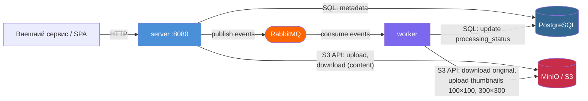
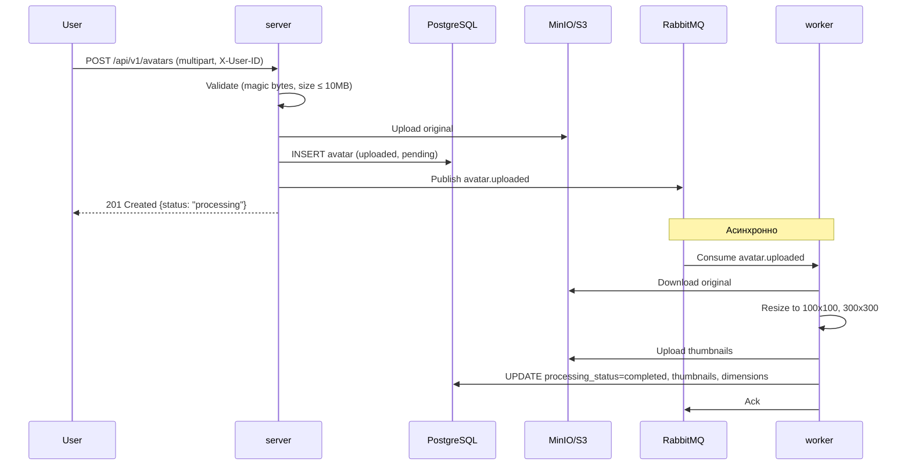
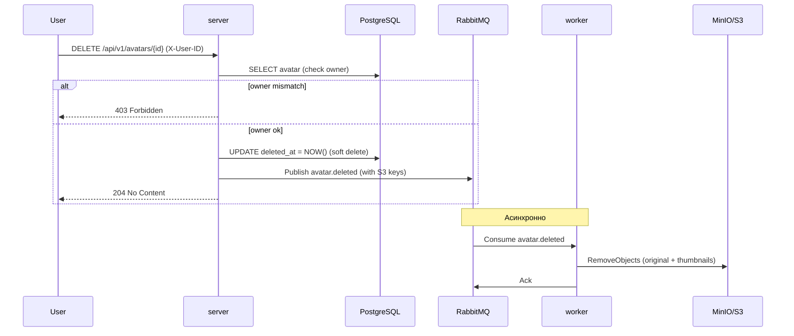
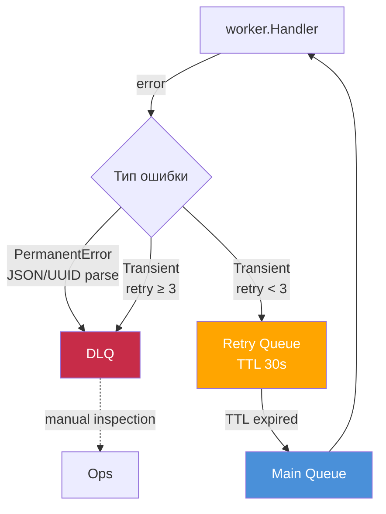

# Шаблонный репозиторий для сервиса "Аватарница"

Это шаблонный репозиторий для выпускной работы по курсу "Go-разработчик". Он содержит базовую структуру проекта, готовую к дальнейшей разработке, а также техническое задание и пример веб-интерфейса.

## Описание

Проект "Аватарница" — это микросервис для управления аватарками пользователей. Он предоставляет REST API для загрузки, получения и удаления изображений, а также простой веб-интерфейс для взаимодействия с сервисом.

## Структура проекта

Проект имеет следующую структуру, основанную на лучших практиках разработки на Go:

```
/
├── cmd/                # Точки входа в приложение (main.go)
│   ├── server/         # HTTP-сервер
│   └── worker/         # Воркер для асинхронной обработки задач
├── internal/           # Внутренняя логика приложения
│   ├── api/            # Спецификации API (OpenAPI/Swagger)
│   ├── config/         # Конфигурация приложения
│   ├── domain/         # Основные доменные сущности
│   ├── handlers/       # HTTP-обработчики
│   ├── migrator/       # Применение миграций при старте (goose)
│   ├── repository/     # Работа с хранилищем (БД, S3)
│   ├── services/       # Бизнес-логика
│   └── worker/         # Логика воркера
├── pkg/                # Публичные библиотеки, которые можно использовать в других проектах
├── web/                # Веб-интерфейс
│   └── static/         # Статические файлы (HTML, CSS, JS)
├── migrations/         # SQL-миграции (goose), встраиваются в бинарник
├── docker/             # Docker-файлы и конфигурации
├── k8s/                # Манифесты Kubernetes
├── tests/              # Интеграционные и e2e тесты
├── docs/               # Документация проекта
└── .gitignore          # Файл для исключения файлов из Git
```

## Как начать работу

1.  **Клонируйте репозиторий:**
    ```bash
    git clone <URL этого репозитория>
    cd go-avatar-service-template
    ```

2.  **Инициализируйте свой репозиторий на GitHub:**
    Следуйте инструкциям GitHub для создания нового репозитория и свяжите его с этим локальным репозиторием.

3.  **Установите зависимости:**
    ```bash
    go mod tidy
    ```

4.  **Настройте окружение:**
    Создайте файл `.env` на основе `.env.example` (необходимо будет его создать) и укажите необходимые переменные окружения (данные для подключения к БД, S3 и т.д.).

5.  **Запустите сервисы с помощью Docker Compose:**
    ```bash
    docker compose -f docker/docker-compose.yml --env-file .env up -d --build --wait
    ```

После этого сервис будет доступен по адресу `http://localhost:8080`.

## Запуск через Docker

Весь стек (инфраструктура + приложение) поднимается одной командой:

```bash
make up
```

Под капотом это `docker compose -f docker/docker-compose.yml --env-file .env up -d --build`.
Сервис будет доступен на `http://localhost:8080`, веб-интерфейс — на `http://localhost:8080/web/upload`.

## Архитектура



### Что поднимается

| Сервис | Контейнер | Порты на хосте | Назначение |
|---|---|---|---|
| `postgres` | `gophprofile-postgres` | 5432 | база данных |
| `minio` | `gophprofile-minio` | 9000, 9001 | S3-хранилище (9001 — консоль) |
| `rabbitmq` | `gophprofile-rabbitmq` | 5672, 15672, 15692 | брокер (15672 — management UI, 15692 — метрики) |
| `server` | `gophprofile-server` | 8080, 9090 | HTTP API (9090 — `/metrics`) |
| `worker` | `gophprofile-worker` | 9091 | обработка событий (миниатюры, удаление); 9091 — `/metrics` и `/health` |
| `jaeger` | `gophprofile-jaeger` | 16686, 4318 | трейсы (UI и OTLP HTTP) |
| `prometheus` | `gophprofile-prometheus` | 9092 | сбор метрик (9092 — потому что 9090 занят `server`) |
| `grafana` | `gophprofile-grafana` | 3000 | дашборды: метрики + логи + ссылки в трейсы |
| `loki` | `gophprofile-loki` | 3100 | хранилище логов |
| `promtail` | `gophprofile-promtail` | — | сбор логов контейнеров через docker-сокет |


### Как это работает





### Порядок запуска

`server` и `worker` ждут готовности зависимостей, а не просто их старта:
`postgres`, `minio` и `rabbitmq` должны пройти healthcheck. Схему БД каждый
сервис создаёт себе сам при старте: `internal/migrator` применяет встроенные
миграции через goose до того, как приложение начнёт обслуживать запросы.
Поэтому сервис нельзя поднять без нужных таблиц, а отдельный шаг деплоя для
миграций не требуется.

### Миграции

SQL-миграции лежат в `migrations/` в формате goose (`-- +goose Up` /
`-- +goose Down`) и встраиваются в бинарник через `//go:embed`. Применяются
автоматически при старте `server` и `worker`, применённые версии хранятся в
таблице `goose_db_version` — повторный прогон ничего не выполняет заново.

Новая миграция — файл `migrations/NNNN_имя.sql` с аннотациями goose; следующий
запуск приложения применит его сам. Одновременный старт `server` и `worker`
безопасен: goose берёт session-level advisory lock на время прогона.

### Retry / DLQ



### Логика:

1) PermanentError (невалидное сообщение) → сразу DLQ.
2) Transient-ошибка → retry-очередь с TTL 30s → возвращается в main → снова handler.
3) После 3 попыток → DLQ.
4) x-death.count инкрементится при каждом dead-lettering (retry → main).

### Полезные команды

```bash
make up            # поднять весь стек (пересобирает образы)
make up-infra      # только инфраструктура (postgres, minio, rabbitmq)
make up-observ     # только стек наблюдаемости (jaeger, prometheus, grafana, loki, promtail)
make build-images  # собрать образы server и worker без запуска
make logs          # логи всех сервисов
make logs-server   # логи server
make logs-worker   # логи worker
make ps            # статус контейнеров
make down          # остановить (данные сохраняются)
make down-v        # остановить и удалить volumes (полная очистка)
```

Проверка состояния приложения:

```bash
curl http://localhost:8080/health
```

`/health` опрашивает БД, S3 и брокер: `200` — всё в порядке, `503` — часть
зависимостей недоступна (в теле ответа видно, какая именно).

### Образы

`Dockerfile` собирает оба бинарника из одного builder-слоя и содержит два
runtime-target'а: `server` (с веб-статикой) и `worker`. Бинарники статические
(`CGO_ENABLED=0`), контейнеры запускаются от непривилегированного пользователя
`app`. Секреты в образ не попадают: `.env` исключён через `.dockerignore`,
значения передаются переменными окружения из `docker-compose.yml`.

### Локальный запуск без Docker

Если инфраструктура уже поднята (`make up-infra`), приложение можно запускать
обычными командами:

```bash
make run-server  # go run ./cmd/server (миграции применит сам)
make run-worker  # go run ./cmd/worker (в отдельном терминале)
```

## Observability

Стек наблюдаемости поднимается вместе с приложением — это те же сервисы
`docker/docker-compose.yml` (`jaeger`, `prometheus`, `grafana`, `loki`,
`promtail`), отдельных конфигураций и запуска не требуется:

```bash
docker compose -f docker/docker-compose.yml --env-file .env up -d --build --wait
# или: make up  (весь стек)  /  make up-observ  (только стек наблюдаемости)
```

### Доступ

| Сервис | URL | Логин |
|---|---|---|
| Jaeger UI | http://localhost:16686 | — |
| Grafana | http://localhost:3000 | admin / admin |
| Prometheus | http://localhost:9092 | — |
| Loki (API) | http://localhost:3100 | — |
| RabbitMQ UI | http://localhost:15672 | guest / guest |
| RabbitMQ metrics | http://localhost:15692 | — |

Prometheus слушает **9092**, а не 9090: порт 9090 на хосте уже занят
`/metrics` сервера.

Три сигнала:

- **метрики** — Prometheus каждые 15 с скрейпит `server:9090/metrics`,
  `worker:9091/metrics` и `rabbitmq:15692/metrics`;
- **трейсы** — `server` и `worker` шлют спаны по OTLP HTTP на `jaeger:4318`
  (переменная `OTEL_EXPORTER_OTLP_ENDPOINT` в compose);
- **логи** — promtail читает stdout контейнеров `server` и `worker` через
  docker-сокет и пушит их в Loki.

### Трейсинг (Jaeger)

Jaeger UI → **Service**: `gophprofile-server` → **Find Traces**. Один трейс
`POST /api/v1/avatars` содержит всю цепочку, включая асинхронную работу воркера:

```
POST /api/v1/avatars          (gophprofile-server)
  S3.Upload, INSERT, INSERT, RabbitMQ.Publish
RabbitMQ.Consume              (gophprofile-worker)
  SELECT, S3.Download, S3.Upload ×2, UPDATE
```

`RabbitMQ.Publish` и `RabbitMQ.Consume` принадлежат **одному** трейсу: trace
context переносится в заголовках AMQP (W3C `traceparent`), поэтому в Jaeger
виден один сквозной трейс, а не два независимых. То же самое видно по логам:
запись `avatar uploaded` на сервере и `avatar processed` в воркере несут
одинаковый `trace_id`.

### Метрики (Grafana / Prometheus)

Grafana → **Dashboards** → `GophProfile — Overview`: HTTP requests rate,
HTTP request duration p95, avatar uploads rate, логи-ошибки.

Напрямую:

```bash
curl http://localhost:9090/metrics   # server
curl http://localhost:9091/metrics   # worker
```

Что смотреть: `http_requests_total`, `http_request_duration_seconds`
(RED-метрики HTTP) и бизнес-метрики `avatars_uploads_total`,
`avatars_upload_duration_seconds`, `avatars_deletes_total`,
`avatars_storage_bytes`, `avatars_file_size_bytes`,
`avatars_processing_duration_seconds`.

### Метрики RabbitMQ

Инфраструктурные метрики отдаёт сам брокер — плагин `rabbitmq_prometheus`
(включён в образ `-management`, порт 15692); Prometheus скрейпит джобом
`rabbitmq`:

```bash
curl http://localhost:15692/metrics | grep rabbitmq_queue_messages
```

Глубина очередей: `rabbitmq_queue_messages_ready` (ждут доставки),
`rabbitmq_queue_messages_unacked` (доставлены, но не подтверждены),
`rabbitmq_queue_consumers` (число потребителей). Рост `_ready` при нуле
`_consumers` означает, что воркер не разбирает очередь.

Значения агрегированы по всем очередям (main, retry, DLQ): по умолчанию
RabbitMQ не отдаёт метрики по объектам, чтобы не раздувать кардинальность.
Разрез по очередям включается настройкой `prometheus.return_per_object_metrics`
в `rabbitmq.conf`, если понадобится видеть конкретную забитую очередь.

### Логи (Loki)

Grafana → **Explore** → Loki:

```logql
{service="server"} |= "error"
{service="server"} | json | trace_id="1f0bdeedd8637f6caa1bced5c54388ad"
```

Приложение пишет JSON-логи (slog), а поля `trace_id` и `span_id` подставляются
автоматически из активного спана. В Loki у `trace_id` настроен derived field,
ведущий в Jaeger: клик по значению открывает тот же трейс — так лог и трейс
связываются без ручного поиска.

### `/health` и трейсы

`/health` намеренно исключён из трейсов (`otelhttp.WithFilter`): Docker
healthcheck обращается к нему каждые 15 секунд, и Jaeger заполнялся бы мусором.
В метриках (`http_requests_total{path="/health"}`) `/health` при этом остаётся.

### Семантические конвенции OTel

Спаны размечены **актуальными** атрибутами OTel semconv, а не устаревшими
именами из ТЗ: `db.system.name` (= `postgresql`), `db.query.text` (шаблон
запроса с плейсхолдерами — значения параметров в трейсы не попадают),
`aws.s3.bucket` / `aws.s3.key`, `messaging.system` (= `rabbitmq`),
`messaging.destination.name`, `messaging.rabbitmq.destination.routing_key`,
`messaging.message.id`.

## Веб-интерфейс

Простой одностраничный веб-интерфейс для загрузки аватарок доступен по адресу `http://localhost:8080/web/upload`. Он находится в файле `web/static/index.html`.

**Важно:** Этот интерфейс предоставлен для облегчения старта и демонстрации работы API. Вы можете изменять его, адаптировать под свои нужды или полностью заменить на свой собственный фронтенд.