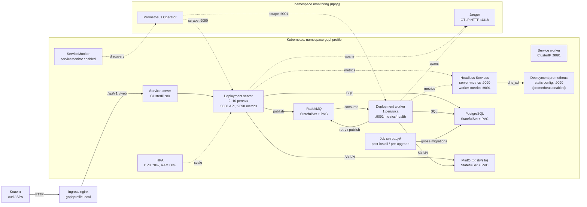
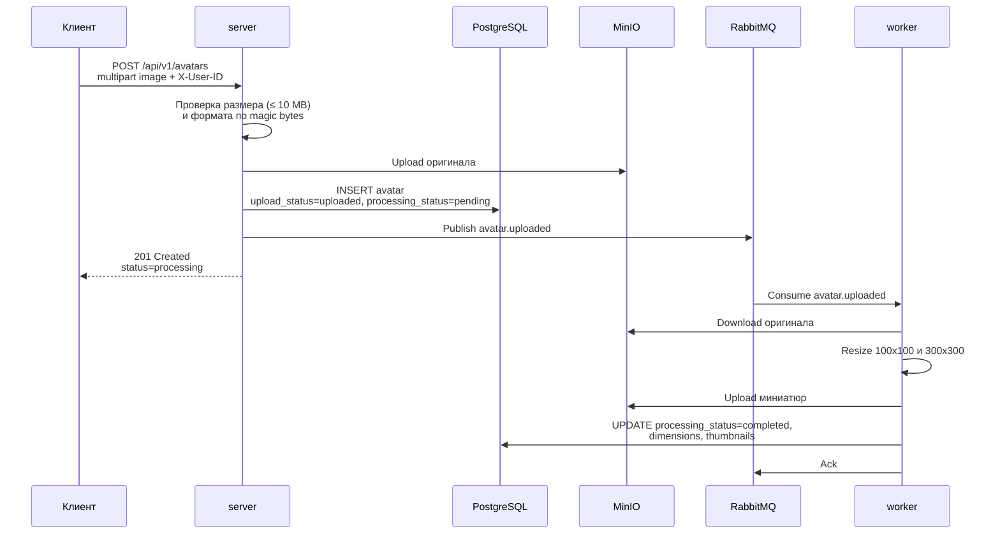
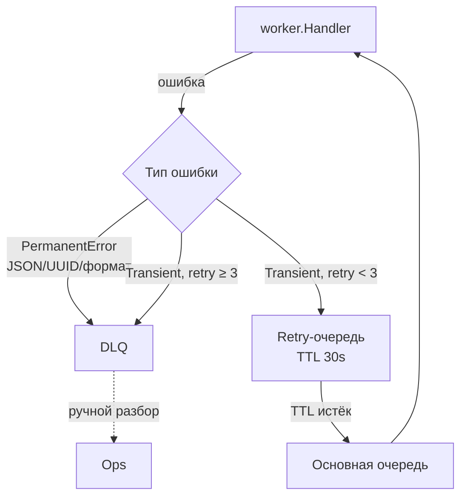
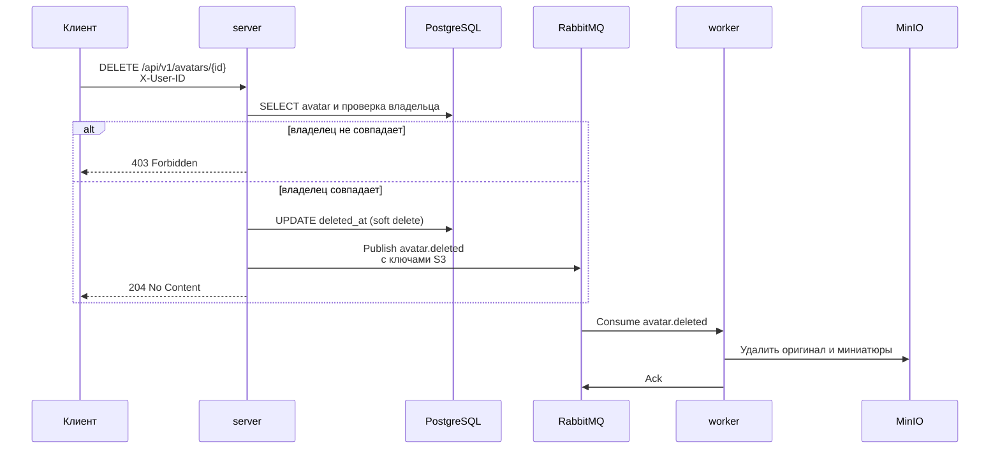

# Архитектура сервиса «Аватарница»

Документ описывает, как устроен сервис в Kubernetes: компоненты, потоки
запросов, наблюдаемость и ограничения локального стенда. HTTP-контракт
вынесен в [openapi.yaml](openapi.yaml), инструкция по запуску — в
[README.md](../README.md).

## Схема

Стрелки показывают логические связи, а не конкретные сетевые политики.
Фактический доступ описан в разделе «Сетевая сегментация».

## Компоненты

| Компонент | Объект Kubernetes | Назначение |
|---|---|---|
| `ingress-nginx` | Ingress `gophprofile` | Принимает внешний HTTP, проксирует в `Service server`; хост задаётся `ingress.host` |
| `server` | Deployment + Service | HTTP API, веб-интерфейс, загрузка в S3, запись в PostgreSQL, публикация событий |
| `worker` | Deployment + Service | Асинхронная обработка: миниатюры, удаление объектов, retry/DLQ |
| `server-metrics`, `worker-metrics` | Headless Service (`clusterIP: None`) | A-записи на каждый под для сбора метрик: обычный Service балансировал бы скрейпы между репликами |
| `prometheus` | Deployment + ConfigMap + Service | Сбор метрик на стенде через `dns_sd_configs`; в проде выключен (`prometheus.enabled: false`) |
| `postgres` | StatefulSet + headless Service + PVC | Метаданные аватарок, статусы обработки, `goose_db_version` |
| `minio` | StatefulSet + headless Service + PVC | S3-хранилище оригиналов и миниатюр (образ `pgsty/silo`) |
| `rabbitmq` | StatefulSet + headless Service + PVC | Очереди `avatar.uploaded`, `avatar.deleted`, retry-очереди и DLQ |
| HPA | HorizontalPodAutoscaler | Масштабирует `server` по CPU/RAM (по умолчанию 2–10 реплик) |
| Job миграций | Job (Helm hook) | Применяет встроенные миграции тем же образом, что у сервера, с `MIGRATE_ONLY=true` |
| ConfigMap / Secret | ConfigMap, Secret | Несекретная конфигурация и учётные данные; при `secrets.existingSecret` Secret создаётся вне чарта |
| ServiceAccount | ServiceAccount | `gophprofile-sa` для приложения и Job, `gophprofile-db-sa` для инфраструктуры; токен не монтируется |
| NetworkPolicy | NetworkPolicy | Default deny + явные разрешения между компонентами |
| ServiceMonitor | CRD `monitoring.coreos.com/v1` | Обнаружение метрик Prometheus Operator; в локальном кластере выключен |

Имена объектов (`server`, `postgres`, `gophprofile-secrets`, …) в чарте
зафиксированы, а не собираются из имени релиза: на них ссылаются переменные
окружения приложения и селекторы NetworkPolicy. Поэтому чарт рассчитан на один
релиз в namespace.

## Потоки

### 1. HTTP-запрос

1. Клиент приходит на Ingress с `Host: gophprofile.local`.
2. Ingress-контроллер проксирует запрос в `Service server` (порт 80 → 8080).
3. `server` проходит цепочку middleware: `RequestID` → `RealIP` → OTel →
   логирование → rate limit → recoverer → timeout → метрики → CORS.
4. Публичные `GET /api/v1/...` доступны без заголовка; `POST` и `DELETE`
   требуют валидный `X-User-ID` (латиница, цифры, `_`, `-`, до 255 символов).
5. Ответ отдаётся JSON (кроме `/content`, который стримит байты изображения).

Полный список маршрутов, коды и схемы — в [openapi.yaml](openapi.yaml).

### 2. Загрузка аватарки

Ключевые свойства:

- оригинал сохраняется до записи в БД; при ошибке публикации сервис возвращает
  ошибку, а `cleanup` воркера перепубликует зависшие `pending`-записи;
- ответ 201 не ждёт обработки: миниатюры появляются асинхронно, поэтому клиент
  опрашивает `GET /api/v1/avatars/{id}` до `processing_status=completed`;
- поддерживаются JPEG, PNG и WebP; неподдерживаемый формат — 400, файл больше
  10 MB — 413.

### 3. Асинхронная обработка и retry

- `PermanentError` (невалидное сообщение, неподдерживаемый формат) сразу уходит
  в DLQ;
- transient-ошибка возвращается в основную очередь через retry-очередь с TTL
  30 секунд; после трёх попыток — DLQ;
- `x-death.count` инкрементируется при каждом dead-lettering;
- раз в минуту `cleanup` ищет `pending`-аватарки старше двух минут и
  перепубликует события — это компенсирует потерянную публикацию без
  отдельного outbox-хранилища.

### 4. Получение и скачивание

- `GET /api/v1/avatars/{id}` — метаданные из PostgreSQL, включая статусы и
  список готовых миниатюр;
- `GET /api/v1/avatars/{id}/metadata` — те же метаданные плюс `dimensions`,
  если оригинал уже обработан;
- `GET /api/v1/users/{user_id}/avatar` — самый свежий аватар пользователя;
- `GET /api/v1/users/{user_id}/avatars` — все аватары (пустой массив, если нет);
- `GET /api/v1/avatars/{id}/content?size=...` — поток байтов из S3:
  `original` (по умолчанию), `100x100` или `300x300`. Ресайза на лету нет:
  неизвестный размер даёт 501. Ответ содержит `Content-Type`,
  `Content-Length`, `Cache-Control: public, max-age=86400` и `ETag`.

### 5. Удаление

`DELETE /api/v1/users/{user_id}/avatar` делает то же самое для самого свежего
аватара пользователя. Удаление из S3 асинхронное: после 204 объекты исчезают
после обработки события воркером.

## Сетевая сегментация

Политики построены по схеме default deny + явные разрешения:

| Под | Входящий трафик | Исходящий трафик |
|---|---|---|
| `server` | `ingress-nginx` → 8080; `app: prometheus` и `monitoring` → 9090 | PostgreSQL:5432, MinIO:9000, RabbitMQ:5672, DNS kube-system:53 |
| `worker` | `app: prometheus` и `monitoring` → 9091 | то же, что у server |
| `postgres`, `minio`, `rabbitmq` | только от `server` и `worker` | не ограничен (политика только на Ingress) |
| `migration` (Helm) | входящий не нужен | PostgreSQL:5432, DNS kube-system:53 |

Метрики открыты namespace `monitoring` (Prometheus Operator в проде) и подам с
меткой `app: prometheus` — это встроенный Prometheus стенда, который живёт в
том же namespace, поэтому `namespaceSelector` его не пропускает. Если
Prometheus установлен в другом namespace или с другой меткой, правила нужно
изменить. Фильтрация проверена на CNI kindnet: под без метки не достучался до
`server-metrics:9090`, под с `app: prometheus` — достучался.

## Наблюдаемость

| Сигнал | Где | Как попадает наружу |
|---|---|---|
| HTTP- и бизнес-метрики | `server:9090/metrics`, `worker:9091/metrics` | На стенде — Prometheus из чарта через headless-сервисы `*-metrics` (`dns_sd_configs`); в проде — Prometheus Operator через ServiceMonitor |
| Трейсы | OTLP HTTP на `jaeger:4318` | `OTEL_EXPORTER_OTLP_ENDPOINT`; `server` и `worker` в одном трейсе через `traceparent` в AMQP |
| Логи | stdout в JSON (slog) | `trace_id` и `span_id` подставляются из активного спана; в Docker-стенде — Loki/promtail |

`/health` и `/live` исключены из трейсов и rate limit: kubelet опрашивает их
часто, и они не должны ни засорять Jaeger, ни получать 429.

Метрики: `http_requests_total`, `http_request_duration_seconds`,
`avatars_uploads_total`, `avatars_upload_duration_seconds`,
`avatars_deletes_total`, `avatars_storage_bytes`, `avatars_file_size_bytes`,
`avatars_processing_duration_seconds` и метрики пула PostgreSQL.

Сбор на стенде проверен: три цели (`server` ×2, `worker` ×1) в состоянии `up`,
серии обеих реплик сервера не затирают друг друга, бизнес-метрики
(`avatars_uploads_total`, `avatars_storage_bytes`) видны в запросах Prometheus.

## Пробы

| Компонент | liveness | readiness | Смысл |
|---|---|---|---|
| `server` | `GET /live` | `GET /health` | `/live` отвечает безусловно; `/health` проверяет БД, S3 и брокер |
| `worker` | `GET /health` на :9091 | `GET /health` на :9091 | у воркера вспомогательный сервер отдаёт `ok` без проверки зависимостей |

У воркера `/health` — это liveness, а не проверка зависимостей: отдельного
readiness-эндпоинта у него нет, подключения проверяются на старте. У сервера
пробы разделены намеренно: падение S3 не должно перезапускать процесс, который
жив и обслуживает запросы.

## Helm и миграции

- `helm/gophprofile` — единственный способ установки всего стека; `k8s/`
  оставлен как набор сырых манифестов для сравнения и отладки без Helm.
- Окружения задаются `values.yaml` (локально), `values-dev.yaml` (1 реплика,
  HPA выключен) и `values-prod.yaml` (3 реплики, HPA до 20, ServiceMonitor,
  внешний Secret, внешний домен).
- Job миграций — хук `post-install,pre-upgrade`. На `install` он запускается
  после создания Secret, ConfigMap и Service `postgres`; на `upgrade` — до
  обновления подов приложения. Повторный запуск безопасен: goose пропускает
  применённые версии.
- Job использует тот же образ, что и `server`, с `MIGRATE_ONLY=true`: процесс
  подключается к БД, применяет миграции и завершается, не поднимая HTTP-сервер,
  `/metrics` и трейсинг.
- `helm uninstall` удаляет объекты релиза, но не PVC: данные PostgreSQL, MinIO
  и RabbitMQ переживают переустановку.

## Ограничения локального стенда

- minikube с нодой 6 GB: приложение и инфраструктура занимают ~1.5 GB, поэтому
  `kube-prometheus-stack` (2–3 GB) не устанавливается. Вместо него метрики
  собирает встроенный Prometheus со static config (`prometheus.enabled: true`):
  ConfigMap, Deployment и Service, без оператора и без персистентного хранилища
  (emptyDir, retention 6h). ServiceMonitor лежит в репозитории как артефакт для
  прода, локально не применялся.
- Ingress-контроллер опубликован как NodePort; для доступа с хоста нужен
  `minikube ip` и порт из `kubectl get svc -n ingress-nginx`, либо
  `kubectl port-forward`.
- CNI kindnet в minikube v1.39 действительно применяет NetworkPolicy; на
  старых CNI политика может существовать, но не фильтровать трафик.
- `EnsureBucket` вызывается при старте без ретраев: если S3 ещё не готов,
  процесс завершается. В кластере это частично компенсируется initContainer'ом,
  но окно между открытием порта и готовностью S3 остаётся (см.
  [tech-debt.md](tech-debt.md)).
- Интеграционные тесты PostgreSQL и S3 требуют заранее поднятых `avatars_test`
  и `S3_ENDPOINT`; publisher использует testcontainers.
